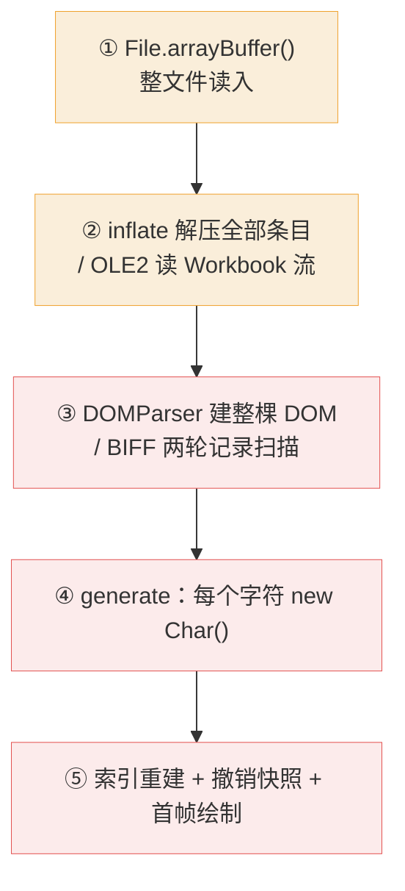
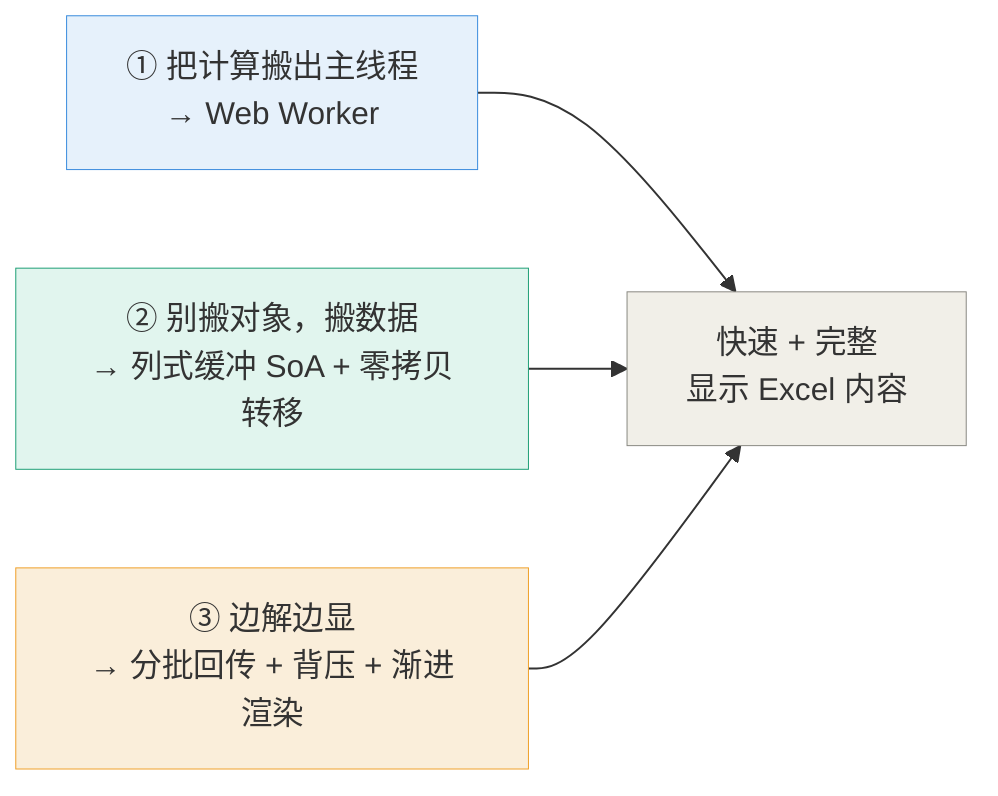
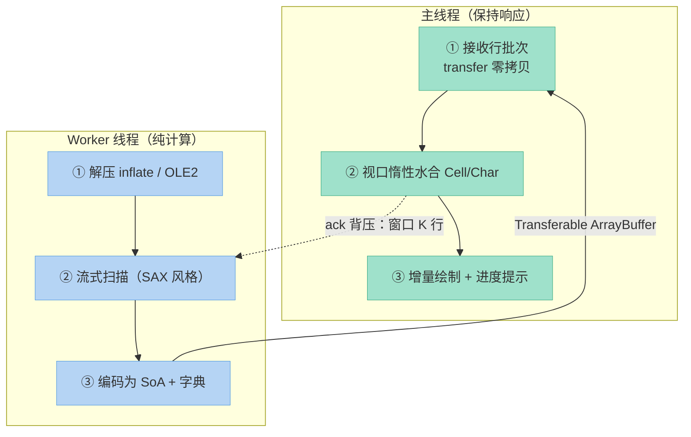
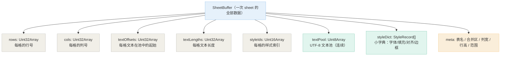
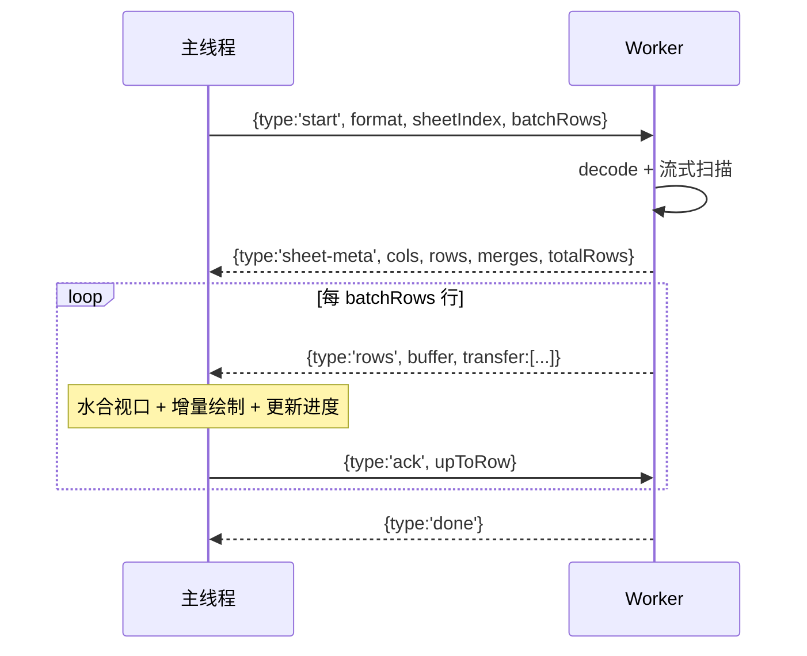
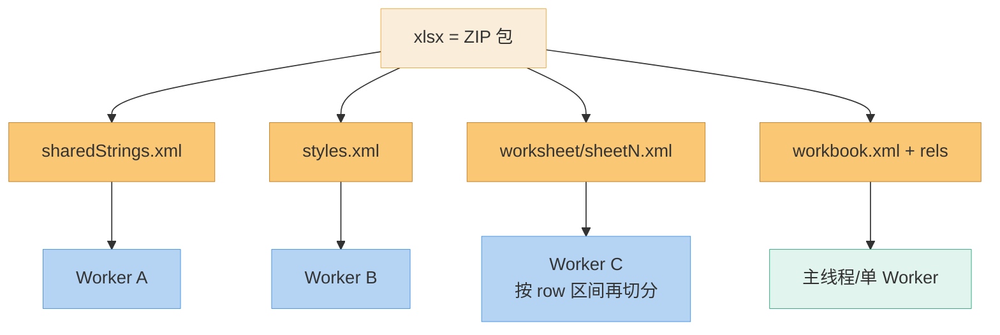
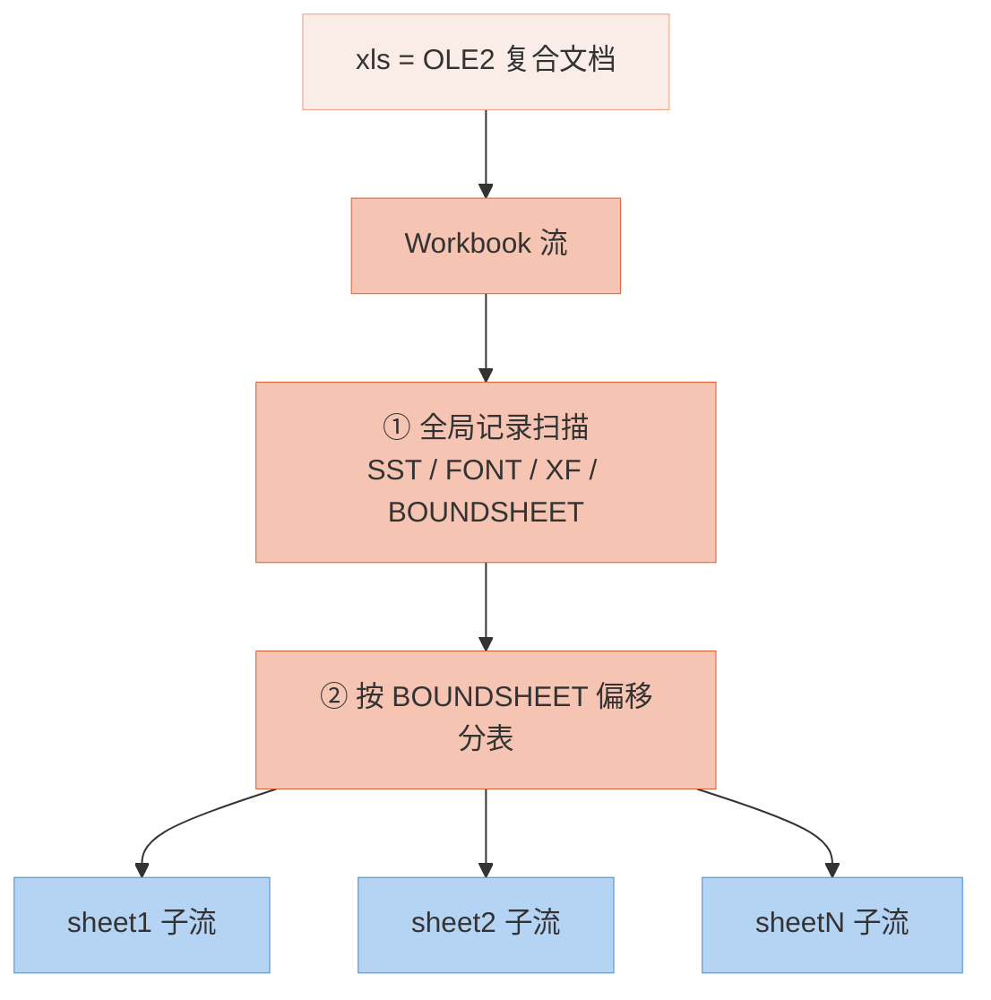
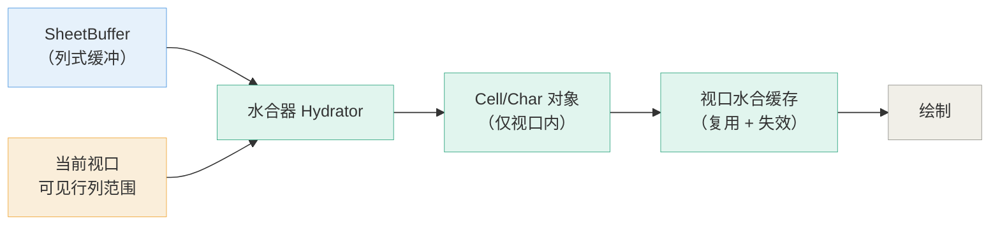

# 大数据量 Excel 多线程解析方案建议

> **文档性质：纯方案建议。** 本文不修改任何源码，仅基于对当前实现的阅读给出设计与落地建议。
>   
> 适用对象：`src/utils/parser/`（xlsx / xls 解析链）与 `src/core/common/fileOpener.ts`（装载链）。

---

## 目录

1. [背景与目标](#1-背景与目标)
2. [现状链路与瓶颈定位](#2-现状链路与瓶颈定位)
3. [总体思路：三件事，别做成一件](#3-总体思路三件事别做成一件)
4. [目标架构](#4-目标架构)
5. [阶段拆解与职责边界](#5-阶段拆解与职责边界)
6. [传输协议设计（决定"快"）](#6-传输协议设计决定快)
7. [xlsx 路径设计与并行策略](#7-xlsx-路径设计与并行策略)
8. [xls 路径设计与并行策略](#8-xls-路径设计与并行策略)
9. [主线程侧：渐进装载与视口惰性水合（决定"完整"）](#9-主线程侧渐进装载与视口惰性水合决定完整)
10. [与既有渲染优化的衔接](#10-与既有渲染优化的衔接)
11. [工程落地要点与已知坑](#11-工程落地要点与已知坑)
12. [实施路线图](#12-实施路线图) · [12.1 实施状态](#121-实施状态本轮已落地) · [12.2 第二轮](#122-第二轮打开大文件仍卡死的实测归因与修复) · [12.3 第三轮](#123-第三轮样式多--图片多就卡的实测归因与修复) · [12.4 第四轮](#124-第四轮大表格里样式合并筛选按钮图片一多就卡的实测归因与修复) · [12.5 第五轮](#125-第五轮位图渲染通道--存档-v4分片-json--稀疏行列头) · [12.6 第六轮](#126-第六轮筛选热路径--清除筛选恢复隐藏行--主表格边缘列行不绘制) · [12.7 第七轮](#127-第七轮筛选按钮加载卡顿--每帧-setfilters-白付一次整表索引重建) · [12.8 第八轮](#128-第八轮筛选按钮加载卡顿的真正真凶--逐列重建稠密矩阵) · [12.9 第九轮](#129-第九轮文件树路径化存档键带目录--拖拽移动--右键菜单与属性对话框)
13. [度量与验收指标](#13-度量与验收指标)
14. [风险与回退](#14-风险与回退)
15. [附录：接口草案](#15-附录接口草案)

---

## 1. 背景与目标

**问题**：在页面中打开大数据量 Excel 时，页面会卡顿甚至崩溃。

**根因（前几轮已诊断）**：不是单一原因，而是三条自我放大的链条叠加：

1. **内存放大**——每字符一个对象、整棵 DOM、多份全量快照；
2. **渲染放大**——O(N²·L) 的全表遍历、逐格线性查找、逐格新建离屏画布；
3. **I/O 放大**——每帧整表序列化并写入 IndexedDB。

其中第 2、3 条已在「第 7 轮性能优化」中处理（视口裁剪、O(1) 名称索引、离屏池、防抖落库、字段级快照比较）。**本文处理的是第 1 条中尚未解决的部分：解析链路本身仍在主线程同步跑完。**

**目标（可度量）**：

| 指标                 | 目标值             |
| ------------------ | --------------- |
| 首屏可见（能看到第一批数据）     | < 300 ms        |
| 主线程单次任务占用          | < 50 ms         |
| 100 MB 级 xlsx 全量解析 | < 2–3 s         |
| 进程峰值内存             | ≈ 文本池 × 2 以内    |
| UI 响应性             | 解析全程可滚动、可输入、可取消 |

> 注意"**快速**"与"**完整**"在这里不是同一件事：解析快 ≠ 显示快，显示完整 ≠ 一次性把全部数据实例化成对象。方案必须同时解这两件事。


---

## 2. 现状链路与瓶颈定位

### 2.1 当前链路（全部在主线程）



五个阶段之间**没有任何让出点**，因此主线程被连续占用，浏览器无法响应输入、无法绘制，最终触发长任务告警或直接 OOM。

### 2.2 具体瓶颈（含代码位置）

| # | 位置                         | 问题                                                               | 后果                              |
| - | -------------------------- | ---------------------------------------------------------------- | ------------------------------- |
| 1 | `sheetParser.ts:232-238`   | `decode()` 遍历 ZIP 全部条目，逐个解压进 `Map<string, Uint8Array>`           | 整包解压后**全部常驻内存**，与原件叠加           |
| 2 | `sheetParser.ts:770-792`   | `readXml()` 用 `DOMParser.parseFromString` 解析每份 XML               | **整棵 DOM 驻留**；DOM 节点内存是原始文本的数倍  |
| 3 | `sheetParser.ts:1005-1073` | `parseWorksheet()` 对每个 `<c>` 调 `getAttribute` / `firstChild`     | DOM 访问是慢路径，逐格开销累积成秒级            |
| 4 | `sheetParser.ts:349-356`   | `sharedStrings` 全量构建 `string[]`                                  | 大文件下共享字符串表本身可达数十万条              |
| 5 | `sheetParser.ts:653-671`   | `generate()` 对文本 `Array.from(text)` 后**每字符 `new Char()`** 并逐字段赋值 | 对象数 = 单元格数 × 平均字数，是最大对象源        |
| 6 | `sheetParser.ts:726-738`   | 行头按 `maxRow` **稠密生成**                                            | `maxRow = 1048575` 时光行头就是上百万个对象 |
| 7 | `sheetParser.ts:718-724`   | 列头按 `maxCol` 稠密生成                                                | 极端情况下同样可观（上限 16384）             |
| 8 | `fileOpener.ts:235-246`    | `applyDocument()` 一次性 `data.values = ...`                        | 触发索引重建 + 撤销快照，O(N) 单次长任务        |

### 2.3 一个关键约束（决定了方案形态）

`DOMParser` 属于 `Window` 专有 API，**在 Web Worker 中不存在**（`Document`、`Element`、`Image` 同理）。因此：

> **"把解析搬进 Worker" 的前提，是先把 `DOMParser` 换成手写流式 XML 扫描器。**

这不是附加条件，而是**必须的前置改造**——而且它本身就是收益最大的单项优化（把内存从 O(全表 XML) 降到 O(一行)），**即使不搬 Worker 也值得先做**。

---

## 3. 总体思路：三件事，别做成一件



- 只做 ①：UI 不卡了，但首屏仍要等全量解析完，且主线程仍要一次性造完所有对象 → **"不卡但慢"**。
- ①+②：主线程只搬运缓冲区，但仍是"全部到齐才显示" → **"快但首屏迟"**。
- ①+②+③：首批数据到达即出画面，其余后台补齐 → **"既快又完整"**。

---

## 4. 目标架构



要点：

- **Worker 只做"计算 → 缓冲区"**，绝不创建 `Cell` / `Char`，也绝不导入 `src/core/**` 的任何模块（保持 Worker 体积小、无副作用）。
- **主线程只做"缓冲区 → 视口对象 → 绘制"**，且水合按视口粒度进行。
- 双向消息带背压，Worker 不会跑在主线程前面把内存撑爆。

---

## 5. 阶段拆解与职责边界

现有三步接口 `decode → extract → generate` 的语义可以**原样保留**，只是把执行位置重新分配：

| 阶段         | 现在                      | 建议                          | 说明                                            |
| ---------- | ----------------------- | --------------------------- | --------------------------------------------- |
| `decode`   | 主线程                     | **Worker**                  | 纯计算（inflate / CFB 目录遍历），无 DOM 依赖，接口最简单、风险最低   |
| `extract`  | 主线程（`DOMParser`）        | **Worker**，但需先改写为流式扫描       | xlsx 不再建 DOM；xls 的 `BiffParser` 原本就是流式游标，可直接搬 |
| `generate` | 主线程（造 `Cell[]`）         | **Worker**，但产物改为 **SoA 缓冲** | 不再造对象，改"编码"                                   |
| 装载         | 主线程 `data.values = ...` | **主线程**，改渐进式                | 见第 9 节                                        |

> 建议保留 `generate()` 这个名字与签名位置，但让它输出 `SheetBuffer`（列式）而非 `Cell[]`；
>   
> 另设一个主线程侧的"水合器"把 `SheetBuffer` 视口片段转成 `Cell`。

---

## 6. 传输协议设计（决定"快"）

### 6.1 为什么不能用对象图

`postMessage(cellArray)` 会走 **structured clone**——几百万个 `Cell`（每个还带 `Map`/`Set`/嵌套对象）的深拷贝会直接卡死主线程，且瞬间制造第二份内存。**必须传缓冲区。**

### 6.2 SheetBuffer：列式（SoA）布局



**这样做的收益**：

- 1000 万格的数据 ≈ `4B×4 + 2B` ≈ 18 B/格 ≈ **180 MB**，若只存文本则更小；相比之下"每格一个对象 + 每字符一个对象"要 **GB 级**。
- 文本池是**连续 UTF-8**，主线程只在需要时才 `TextDecoder` 切出视口那几十个字符串——**绝大多数单元格永远不需要变成 JS 字符串**。
- 样式用**索引 + 小字典**，重复样式不重复存储。

### 6.3 消息协议与背压



- **批次大小**：建议 2–5 万行/批，按实测调整。
- **背压**：Worker 在未收到 `ack` 前最多领先 **K 批**（K=2 较稳妥）——保证主线程内存不被灌满。
- **可取消**：主线程发 `{type:'cancel'}`，Worker 下一批次检查标志位后中止（因为 Worker 循环里有天然让出点）。
- **进度**：`totalRows` 在 sheet-meta 阶段从 `<dimension>`（xlsx）/ `DIMENSIONS` 记录（xls）取得，用于真实进度条。

### 6.4 传输方式选择

| 方式                               | 何时用                      | 代价                                                                                                           |
| -------------------------------- | ------------------------ | ------------------------------------------------------------------------------------------------------------ |
| `postMessage(buf, [buf])` **转移** | 默认方案                     | 零拷贝，但所有权移交，发送方失去引用                                                                                           |
| `SharedArrayBuffer`              | 需多个 Worker **共读同一份文件字节** | 需服务端下发 `Cross-Origin-Opener-Policy: same-origin` + `Cross-Origin-Embedder-Policy: require-corp`；否则 `SAB` 不可用 |
| structured clone                 | ❌ 不要用于单元格数据              | 深拷贝，O(对象数)                                                                                                   |

> 建议**先用转移**。只有当确认要"多 Worker 并行读同一份未解压字节"时，再引入 `SAB` + COOP/COEP 并评估部署影响（COEP 会连带影响页面内所有跨域子资源）。

### 6.5 Worker 内应避免的事

- 不要 `import` `src/core/**`（会连带 `EventEmitter`、常量表、甚至 `DOMParser` 依赖）。
- 不要创建 `Cell` / `Char`——它们是"活数据模型"，只应由主线程持有。
- 不要在 Worker 内做字体测量（每个 Worker 都要重新 `loadFont`，成本高且收益为负）。

---

## 7. xlsx 路径设计与并行策略

### 7.1 结构特征

xlsx 是 ZIP 包，**各条目彼此独立**，这给了天然的并行空间：



### 7.2 建议步骤

1. **Worker 0（协调）**：解析 `[Content_Types].xml`、`xl/workbook.xml`、`xl/_rels/workbook.xml.rels`，拿到表名与 `sheetN.xml` 路径，以及目标 sheet 的 `<dimension>`（用于进度）。
2. **并行解压**：`sharedStrings.xml`、`styles.xml`、`sheetN.xml` 分派给不同 Worker。ZIP 的中央目录在文件尾部，**每个 Worker 都需要那份字节**：
   - 若不方便改部署头（COOP/COEP），可让协调 Worker 解压后**把解压产物按需转移**给负责扫描的 Worker；
   - 若可加响应头，用 `SharedArrayBuffer` 让多个 Worker 共读同一份字节最省内存。
3. **单表内再切分**：超大 `sheetN.xml` 可按 `<row>` 边界切段（每段以一个完整 `<row>` 起始为准）。段边界天然对齐，不需要 XML 上下文——**这正是流式扫描器带来的额外红利**（DOM 做不到这一点）。
4. **合并顺序**：各段返回的 `SheetBuffer` 片段按行区间拼接（行号单调，可直接归并，无需排序）。

> 注意事项：`sharedStrings` 是**全局前置依赖**——所有 sheet 扫描都要用它做 `t="s"` 的索引解引用。因此它必须**最先完成**；或者退一步：扫描阶段先输出"共享字符串索引"，在主线程按需解引用（可进一步并行化，但会增加协议复杂度，建议二期再做）。

### 7.3 `sharedStrings` 的处理

- 现状 `sheetParser.ts:349-356` 把所有 `<si>` 收进 `string[]`。大文件下这本身可观。
- **建议**：流式扫描 `<si>`，直接写入 SheetBuffer 的 `textPool`，并建一张 `Uint32Array` 的"索引 → 池内偏移"表。这样共享字符串与普通文本**共用同一个池**，不再有独立的 `string[]`。

---

## 8. xls 路径设计与并行策略

### 8.1 结构特征

`biff.ts` 的文件头已经说明清楚：BIFF 是**一串连续的记录**，工作表位置由 `BOUNDSHEET` 记录给出，解析需**两轮扫描**，且 `SST` 用 `CONTINUE` 片段拼接——**本质是顺序的**。




### 8.2 建议步骤

1. **必须顺序**：第一轮全局记录扫描（`SST` / `XF` / `FONT` / `BOUNDSHEET`）在单个 Worker 内顺序完成。`SST` 的 `CONTINUE` 拼接逻辑（`biff.ts` 头注释里最棘手的那部分）原样保留，**不要**尝试并行化它。
2. **可并行点**：第二轮按 `BOUNDSHEET` 偏移把**每个工作表**分派给独立 Worker（仅当有多个大表时才有意义；单大表时并行度就是 1）。
3. **单表内不可切分**：BIFF 记录没有与 XML 等价的"安全分片边界"，单表内只能顺序推进——但**因为已在 Worker 里**，顺序推进也不阻塞 UI，配合分批回传同样能实现渐进显示。

> 结论：**xls 的收益主要来自"搬出主线程 + 流式分批"，而不是"多 Worker 并行"。** 不要为了并行而并行，切分开销可能吃掉收益。

---

## 9. 主线程侧：渐进装载与视口惰性水合（决定"完整"）

这是"完整显示"能否成立的关键。**不要把 SheetBuffer 一次性全量水合成 `Cell[]`**。



### 9.1 具体做法

1. **数据源双形态**：`DataCollection` 增加"大表模式"——此时 `values` 由一个 `SheetBuffer` 支撑，而不是 `Cell[]`。
2. **按需水合**：`getCellByName(name)` 在命中 `SheetBuffer` 的区间时，**即时水合该格**并写入视口缓存。由于第 7 轮已把索引改成 O(1)，这里可以做到"未水合格返回 `undefined` / 惰性对象"，绘制侧逻辑几乎不用改。
3. **视口缓存失效**：缓存以"视口矩形 + 世代号"为键，滚动时只淘汰离开视口的条目。
4. **编辑语义**：**一旦某格被编辑，就把该格从 `SheetBuffer` 提升为真实 `Cell`**（写回 `values`），进入常规可变路径。这样"只读的大表"和"被你改过的小块"共存，语义清晰。
5. **行列头虚拟化**：彻底去掉 `sheetParser.ts:718-738` 的稠密生成，改为按 `offset` 现算 `left/top/width/height`（表头本来就已经是"按需取"的数据结构，改造量小）。**这一条即使不做 Worker 也应先做**——它是"大表打开就崩"的直接原因之一。
6. **撤销快照策略**：超过阈值（建议 50 万格）时**不记录全量状态快照**，只记录"文件级操作"（打开/切换），并明确告知用户"大文件不参与单元格级撤销"。避免解析完立刻再来一次 O(N) 内存峰值。

### 9.2 时间切片（保证 < 50ms）

- 主线程处理每个批次时，用 `requestAnimationFrame` / `requestIdleCallback` 切片，**每片处理预算 ~16ms**，超出即让出。
- 进度 UI 与"取消"按钮必须在整个过程中可交互。
- 首屏策略：**首批 `rows` 消息到达就立即装载并绘制**，不等全量。用户体感从"等 8 秒出现画面"变成"0.3 秒出现画面，2 秒后数据补齐"。

---

## 10. 与既有渲染优化的衔接

第 7 轮已落地的能力，正好是本文方案的**必要基础**，无需返工：

| 既有能力 | 在本方案中的作用 |
|---|---|
| `getCellByName()`（O(1) 名索引） | 惰性水合时按名取格，不再需要全表扫描 |
| `getVisibleCells()`（视口裁剪） | 水合器的"要水合哪些格"直接来自它 |
| `getMergedCells()` / `getFilterCells()`（缓存） | 大表下合并区/筛选按钮不再每次 O(N) |
| `cell.ts` / `char.ts` 去掉 EventEmitter | `Cell`/`Char` 变轻，水合成本大幅下降 |
| 字符宽度缓存 + 离屏画布池 | 视口绘制不再逐格新建画布 |
| 防抖落库 + `flushPendingSave()` | 渐进装载期间不会每批都写库 |
| 字段级撤销快照比较 | 卸载/切换时的比较不再是整表 `JSON.stringify` |

**换句话说：渲染侧的"快速"已经解决，本方案补的是"解析侧的快速"和"装载侧的完整"。**

---

## 11. 工程落地要点与已知坑

### 11.1 构建配置（已按此落地）

1. **`import.meta` 不可用 → 改用「独立配置 + 固定文件名」**：`tsconfig.json` 仍是 `module: "ES6"`，
   webpack 5 推荐的 `new Worker(new URL('./x.worker.ts', import.meta.url), {type:'module'})`
   依赖 `import.meta`，TS 会直接报错；而**改 `module` 为 `esnext` 会波及整个项目**，风险不划算。
   最终采用**双配置**方案：`webpack.config.js` 导出一个数组 —— 主配置 + `target: 'webworker'` 的
   worker 配置，后者 `output.filename` 固定为 `parser.worker.js`。主线程用相对文档路径
   `new Worker('parser.worker.js')` 实例化（支持部署在任意子路径）。
   > 两个配置都输出到 `dist`，若各自开 `output.clean` 会**互相删除产物**，故在配置文件顶层
   > 用 `fs.rmSync(dist)` 做一次「构建前统一清空」（`WEBPACK_SERVE` 下跳过）。
2. **`target: "ES5"`**：主配置保持不动；worker 配置由 webpack 的 `webworker` target 产出，
   产物经检查不含 `document.` / `window.` 引用，是可直接投递的 classic worker 脚本。
3. **`parserClient` 内不得出现 `import.meta`**：本仓库的 Node 测试用 `ts.transpileModule`
   以 CommonJS 加载源码，`import.meta` 会直接产出语法错误。因此 worker 的定位完全靠
   **固定文件名的相对 URL**，不依赖 `import.meta`，测试链路不受影响。

### 11.2 Worker 环境 API 可用性

| API | Worker 内 | 备注 |
|---|---|---|
| `TextDecoder` | ✅ | 文本池解码主力 |
| `DecompressionStream` | ✅ | `inflate.ts` 已在用，原生解压仍走它 |
| `OffscreenCanvas` | ✅ | 但字体需各自 `loadFont`，不建议在 Worker 测量 |
| `FileReaderSync` | ✅ | 同步读文件（Worker 专属） |
| **`DOMParser`** | ❌ | **必须改为手写流式扫描器** |
| `Document` / `Element` | ❌ | 同上 |
| `Image` | ❌ | 图片解码用 `createImageBitmap` |

### 11.3 其他注意点

- **`MAX_ENTRY_SIZE`（`zip.ts:42`，512 MB）保留**。它防的是单条目的 ZIP 炸弹；而真正导致崩溃的是"全表 DOM + 每字符对象 + 稠密行头"的**叠加**——两者解决不同问题，不要互相替代。
- **`File.arrayBuffer()` 会读入整份文件**（`sheetParser.ts:225`）。ZIP 需要随机访问尾部中央目录，所以很难完全避免；但应**尽早把 `ArrayBuffer` 转移给 Worker**，避免主线程长期持有第二份副本。
- **字体测量留在主线程**：Worker 内测量需要为每个 Worker 重复加载字体，成本高于收益。
- **不要在 Worker 里 `import` `src/core/**`**：会让 Worker 打包体积膨胀并牵连主线程模块。
- **`colToName()` 按格调用**（`sheetParser.ts:630`）：建议按列缓存（同一列的列名固定），减少重复字符串拼接。

---

## 12. 实施路线图

按"收益 ÷ 风险"排序，每一步都可独立上线：

| 阶段 | 内容 | 独立收益 | 风险 |
|---|---|---|---|
| **P0** | `DOMParser` → 手写流式 XML 扫描器（仍留在主线程） | 内存从 O(全表 XML) 降到 O(一行)；速度提升显著 | 低（接口不变，可用现有测试对拍） |
| **P1** | 去掉稠密行列头 + `Char` 惰性化（`Char.of()` / 共享字体对象） | 消除上百万对象的直接来源 | 低 |
| **P2** | `decode()`（inflate / OLE2）搬进 Worker，字节用 transfer | UI 不再被解压卡死 | 低（纯计算，接口最简） |
| **P3** | `extract + generate` 搬进 Worker，输出 `SheetBuffer`；主线程渐进水合 + 进度条 + 取消 | 首屏 < 300ms，全程可交互 | 中（协议与状态机需仔细设计） |
| **P4** | xlsx 走 Worker 池（条目并行 + 单表 row 区间切分）；xls 按 `BOUNDSHEET` 分表 | 大文件墙钟时间再降 | 中（`SAB` / 部署头 / 归并一致性） |
| **P5（可选）** | inflate + 扫描下沉 WASM（Rust/C++） | 再提速 2–5× | 高（新增构建链与产物） |

> **强烈建议至少先做 P0 + P1**：这两步不引入任何多线程复杂度，却直接砍掉"崩溃"的两个主因。P2 之后才进入真正的"多线程"范畴。

### 12.1 实施状态（本轮已落地）

| 阶段 | 状态 | 落地内容 | 涉及文件 |
|---|---|---|---|
| **P0** 流式 XML 扫描 | ✅ 已完成 | 新增 SAX 风格扫描器 `xmlScanner`（单趟逐字节、内存 O(1)、无 DOM 依赖）；xlsx 的 `workbook.xml` / rels / `sharedStrings.xml` / `styles.xml` / `sheetN.xml` / drawing 全部改走扫描器，`DOMParser` 与 `getElementsByTagName` 已从源码中彻底移除 | `src/utils/parser/xmlScanner.ts`（新增）、`sheetParser.ts` |
| **P1** 生成端优化 | ✅ 已完成（部分） | ① `colToName` 按列号缓存（百万格省掉百万次字符串构造）；② 字体样式改成"模板 + 稀疏克隆"（`Char.fromRaw`），停止逐字符 7 次条件赋值；③ 合并映射用数值键 `row*16384+col` 取代模板字符串键；④ `fileOpener.applyHeaders` 不再对百万行头做一次全量克隆 | `sheetParser.ts`、`core/common/fileOpener.ts` |
| **P2** Worker 搬迁 | ✅ 已完成（decode + extract + pack） | 新增 worker 入口与客户端封装；`decode` + `extract` 移入 Worker，文件字节与图片二进制走 `ArrayBuffer` **transfer 零拷贝**；Worker 不可用（老浏览器 / 产物缺失 / Node 测试）**自动回退主线程**；webpack 拆出独立 worker 配置，产物固定为 `parser.worker.js`。**第二轮追加**：回包由"原样 `ExtractedSheet[]`"改为**列式打包**（见 §12.2），主线程反序列化从 489 ms 降到几毫秒 | `src/utils/parser/parser.worker.ts`（新增）、`parserClient.ts`（新增）、`cellSource.ts`（新增）、`core/common/fileOpener.ts`、`webpack.config.js` |
| **P3** 主线程渐进水合 | 🟡 部分完成 | ① **SoA 缓冲已落地**（§12.2：Worker 回传列式打包，主线程按列水合）；② `generate` 已改**分片让出**（每片 12 ms），不再有整段长任务；③「视口惰性水合」（只把落进可视区的格子对象化）仍未做 —— 需要编辑/选区/矩阵运算全链路都改成按需水合，风险较大 | `cellSource.ts`、`sheetParser.ts`、`utils/scheduler.ts` |
| **P4** Worker 池 / 条目并行 | ⬜ 未开始 | — | — |
| **P5** WASM 下沉 | ⬜ 未开始 | — | — |
| **P6** 图片与样式代价（第三轮追加） | ✅ 已完成 | ① `xl/media/**` 默认**连解压都不做**（`readImages` 默认 false，`DecodedWorkbook.mediaSkipped` 如实标记）；② 修好关系目标相对路径解析（`resolveZipTarget`），位图提取不再是死代码（原来 `../media/x.png` 必然查不到）；③ 样式按 xf/XF 编号**内联缓存**（同编号必同对象）+ `ExtractedCell.styleId`；④ 打包按编号去重（不再逐格 `JSON.stringify`）；⑤ 存档 **v3 样式表**（`CellStyleTable`） | `sheetParser.ts`、`cellSource.ts`、`cell.ts`、`dataCollection.ts` |

**与方案的两处自觉偏离（及理由）**

1. **P1 的"去掉稠密行列头"未做**：`Header` / `ColHeaders` / `RowHeaders` 及其消费方（canvas / editCanvas / scroller）全部建立在"按索引取数组元素"的稠密模型上，虚拟化需要改动整套表头模型，风险与工作量都远超本轮范围。本轮只消除了 `applyHeaders` 里那次**多余的全量克隆**。已登记为后续项。
2. **P2 只搬 `decode + extract + pack`，`generate` 留在主线程**：`SheetParserResult` 含 `Cell` / `Char` **类实例**，跨线程结构化克隆会丢原型（`getText()` 等方法失效）。因此 Worker 回传**纯数据的列式打包**（`PackedSheet[]`），主线程再 `generate`。第二轮已把"回包克隆"这一环从 489 ms 打到几毫秒（§12.2），并把 `generate` 改成分片让出；Cell/Char 的一次性构造开销要等 P3 的视口惰性水合才彻底解掉。

**新增回归测试**

| 测试 | 覆盖 | 结果 |
|---|---|---|
| `test/test-xml-scanner.js` | 扫描器语义：元素/属性/文本/实体/自闭合/CDATA/注释/DOCTYPE/容错 | 27/27 |
| `test/test-xlsx-parse.js` | xlsx 流式全链路对拍（内存构造 xlsx：共享字符串/富文本/各类型值/样式/合并/行列尺寸）+ 列名缓存 + 字体模板 + 反回归守卫（源码不得再出现 `DOMParser`） | 67/67 |
| `test/test-parser-client.js` | 客户端协议（请求负载 + transfer 列表 + 回包 → 主线程 generate）与三类回退分支（无 Worker / 构造失败 / `onerror`）+ 错误不回退 | 20/20 → 24/24（第二轮追加列式打包守卫） |
| `test/test-worker-bundle.js` | **直接执行 `dist/parser.worker.js`**，模拟 Worker 作用域投递真实请求并断言回包 | 13/13 → 18/18（第二轮改为用真实水合路径断言） |

> ⚠️ 待人工确认：Worker 的**浏览器端**行为（真实 `new Worker('parser.worker.js')` + 大文件 transfer）尚未在本环境验证。产物已在 Node 中按 Worker 作用域执行通过，且客户端具备自动回退，故即使 Worker 异常也不会让"打开文件"失效。

### 12.2 第二轮：'打开大文件仍卡死' 的实测归因与修复

§12.1 落地后实测仍会卡。用真实文件（648 KB xlsx / 6.3 万格，其中 6.2 万格带样式）
逐阶段打点后才发现：**最大的那段主线程阻塞不在解析，而在 Worker 回包的反序列化**。

| 阶段（真实 648 KB 文件） | 耗时 | 归属 |
|---|---|---|
| `decode` + `extract` | 35 + 179 ms | Worker（主线程无感） |
| **Worker 回包结构化克隆（原样 `ExtractedCell[]`）** | **327～489 ms** | **主线程** |
| `generate`（映射 Cell/Char） | 20～39 ms | 主线程 |
| `toJSON` + 写库（打开后防抖触发） | ≈ 500 ms（40 万格口径） | 主线程 |
| `fromJSON`（刷新 / 切文件装载） | ≈ 1.2～1.4 s（40 万格口径） | 主线程 |

**根因**：结构化克隆要**逐对象**重建，`ExtractedCell` 每格还挂一个嵌套样式对象
（6.2 万格 → 6.2 万个样式对象）。把它换成列式（SoA）后：

| 回传形态 | 主线程反序列化 | 常驻内存增量 |
|---|---|---|
| `ExtractedCell[]` 原样 | 327～489 ms | 58.3 MB |
| 列式打包（typed array + transfer） | **2～6 ms** | 11.7 MB |

**A. 列式打包回传（本轮落地）**

- 新增 `src/utils/parser/cellSource.ts`：
  - `SheetSource` 抽象，让 `generate` 有**一份映射实现**、两种数据来源（数组式 / 列式）；
  - `packSheet(s)`：平行数组 `row/col/kind/num/styleIndex/formatIndex` + **样式去重表** + **单一文本池** `text`/`textStart`；
  - `packTransferables`：全部 typed array 与图片二进制走 `transfer`（零拷贝）；
  - `PackedSheetSource`：主线程侧 O(1) 取行列/文本/样式/数字格式。
- Worker 由"回传 `ExtractedSheet[]`"改为"回传 `PackedSheet[]`"；`parserClient` 改走
  `parser.generatePacked(...)`。打包本身（6.3 万格约 91 ms）留在 Worker 里，主线程无感。

**B. 撤销记账降级（大表只记文件级）**

`DataCollection` 新增 `LARGE_TABLE_UNDO_CELLS = 100000`：超过阈值后不再做整表深拷贝基准
（`_lastValuesSnapshot = null`）、`beginContinuousUndo` 返回 null、全量状态操作不入撤销栈；
回到小表自动恢复（非粘性）。

**C. 分片让出（把"整段长任务"变成"< 20 ms 的小片"）**

- 新增 `src/utils/scheduler.ts`（`SliceBudget` / `yieldToUI`），`sheetParser` 与
  `DataCollection` 共用同一份实现；
- `generate` → `async`，逐格构造按 12 ms 预算分片；
- `toSnapshotText()`（**与 `toJSON()` 输出逐字节相同**，共用 `_snapshotParts` 生成器）：
  落库路径不再整段阻塞；
- `fromJSONChunked()`（**与 `fromJSON()` 逐格等价**，共用 `_decodeValueRange`）：
  刷新页面 / 切换文件的装载不再整段阻塞；
- `flushPendingSave()`（页面卸载）保持同步 `toJSON()`：那时没有让出的机会。

**D. 复测（合成 40 万格，每格一个独立样式对象）**

| 指标 | 修复前 | 修复后 |
|---|---|---|
| 打开路径主线程阻塞（回包克隆 + 水合） | 2914～3829 ms | **613～813 ms** |
| 其中最长单段同步阻塞 | 2914 ms | **≤ 42 ms**（分片生效） |
| 回包常驻内存增量 | 622～684 MB | 327～389 MB |
| 内容一致性 | — | 两条路径逐格逐字段一致 ✅ |

**E. 仍未解决（实测地板）**

| 项目 | 实测 | 说明 |
|---|---|---|
| `JSON.parse` 整份快照 | 40 万格 44.5 MB 快照 **951 ms**（膨胀维度 72.5 MB → 1189 ms） | **不可分片**，是装载路径的剩余地板；要再降只能改存储形态（IDB 直接存列式对象 / 紧凑二进制），属下一步 |
| 稠密行列头 | `maxRow=1,048,576` 时多花约 150～200 ms、快照多 28 MB | 表头虚拟化需重构 `ColHeaders`/`RowHeaders` 及其全部消费方，风险高，仍未做 |
| 单元格式工作簿主线程水合 | 40 万格 ≈ 610～810 ms（已分片，无 > 50 ms 单段） | 视口惰性水合（P3）才能再降 |


**新增回归测试**

| 测试 | 覆盖 | 结果 |
|---|---|---|
| `test/test-cell-pack.js` | 打包形态（去重/文本池/transfer 完整）+ 水合与数组式逐格等价 + `generate` 与 `generatePacked` 产出完全一致 + 真实 xlsx 两条路径对拍 + 边界（空表/空输入/越界 sheetIndex） | 45/45 |
| `test/test-persist-slice.js` | `toSnapshotText ≡ toJSON`、`fromJSONChunked ≡ fromJSON`（含遗留双层编码）、分片确实让出、**并发让出不被吞（3b）**、空闲落库（`requestIdleCallback`）、大表降级不再深拷贝、卸载仍取同步快照 | 39/39 → 46/46 |
| `test/test-parser-client.js` | 原有协议/回退分支 + **新增反回归守卫**：回包必须是列式打包（不得退回逐格对象数组） | 24/24 |
| `test/test-worker-bundle.js` | 直接执行 `dist/parser.worker.js`，用**真实水合路径** `PackedSheetSource` 还原后断言值/样式/合并/行列尺寸 | 18/18 |
| `test/test-xlsx-parse.js` | 端到端解析 + `generate` 优化 + 反 DOM 守卫 + **图片默认不读/显式读图的相对路径解析** + **样式内联缓存与打包去重** | 67/67 → 87/87 |
| `test/test-file-switch.js` | 切文件/存档格式：遗留双层编码、**v3 样式表往返（含逐字符样式 + 单元格样式混合、纯样式格）**、v2 存档仍可读、`blankSnapshot` | 133/133 → 149/149 |

> 手工基准（非 CI）：`node --expose-gc test/_bench-real.js "<某个大 xlsx>"`
> 与 `node --expose-gc test/_bench-large.js`，可复现上表数字。
> 第三轮追加 `node --expose-gc test/_bench-images-styles.js`（图片密集 / 样式密集）。

---

### 12.3 第三轮：「样式多 / 图片多就卡」的实测归因与修复

**新基准**：`test/_bench-images-styles.js`（合成图片密集 / 样式密集的 xlsx，
并对比 `readImages` 两条路径与旧式逐格样式对象）。

**A. 归因（都是实测出来的浪费，不是猜测）**

| 现象 | 实测代价 | 根因 |
|---|---|---|
| 图片多的文件打开慢、内存高 | `decode` 把 `xl/media/**` **全部 inflate**：37.5 MB 媒体 → **657 ms / +150 MB**；93.8 MB 媒体 → **838 ms / +199 MB** | 项目**没有图片渲染基建**（`fileOpener` 直接丢弃 `result.images`），这份代价 100% 是浪费 |
| 同上，且图片“一张都没用上” | 提取到 **0 张**图片 | 关系目标 `Target="../media/x.png"` 被写死成 `xl/${target}` → 查不到条目（**位图提取一直是死代码**）；`../drawings/drawing1.xml` 同理 |
| 样式多时提取慢、内存高 | 20 万格带样式：提取 **978 ms**，内存里 **20 万个**内容重复的样式对象（实际只有 5000 种） | `styleFromXf` 逐格新建 `style`+`font`+`fill`+`alignment`+`border`，**无缓存** |
| 样式多时回包打包慢 | **620 ms**（20 万格） | `packSheet` 对每格 `JSON.stringify(style)` 求去重键 |
| 样式多时快照大、装载卡 | 20 万格带样式：快照 **30.0 MB**、`JSON.parse` **388 ms** | 样式字段逐格内联；`JSON.parse` 不可分片 |
| **并发分片会静默停住** | 基准脚本直接静默退出（exit 0） | `yieldToUI()` 用**单个** `onmessage` 槽存放 resolver：两处分片任务并发时后者覆盖前者，前一个 promise **永不 settle**（浏览器里 = 这次自动保存再也不会写完） |

**B. 修复**

1. **图片：不读就不解压**（新增 `SheetParser.isMediaEntry`）
   - `decode(file, options)` 只字未提图片时**跳过 `media/` 条目的 inflate**；
     `readImages` 默认 **false**（`extract` 同步改默认值），并在 `DecodedWorkbook.mediaSkipped`
     如实标记「这次解压跳过了媒体」。
   - `readImages` 必须在 **decode 阶段**声明；媒体不再补解压，这是接口语义。
   - 顺手修好位图提取的路径解析（新增 `SheetParser.resolveZipTarget`）：相对目标
     `../media/...`、`../drawings/...`、包内绝对路径 `/xl/...` 都能解析，
     `workbook.xml.rels` 也改用它（原来写死 `xl/` 前缀，遇 `../` 就错）。
2. **样式：按编号内联缓存**（`parseWorksheetBytes` / `extractXls`）
   - 每个 xlsx `cellXfs` 索引 / xls XF 索引只解析一次，同编号**必复用同一个对象**；
     `ExtractedCell.styleId` 记录编号，供下游直接使用。
3. **样式：打包按编号去重**（`packSheet`）
   - 有 `styleId` 时一次数字查表即可（并校验「同编号必同对象」，异常来源退回内容比较）；
     无 `styleId` 的旧/手工来源仍按 `JSON.stringify` 内容去重，行为不变。
4. **存档 v3：样式表**（`CellStyleTable` + `Cell.toCompact(table)`）
   - 单元格样式 + 整格统一字体合并为一条表项，单元格只写 `s: <编号>`；
     表项集中在快照尾部 `"styles":[...]`。
   - `e/cs/rs`（编辑标记、合并跨度）是**结构信息**，逐格不同、无重复可言，仍内联。
   - 单元格级样式内联在 v2 的【逐字段写 → 文本 → 字体】顺序**保持不变**（`toCompact()` 无表模式仍逐字节同旧）。
   - `fromJSON` / `fromJSONChunked` 共用 `_decodeValueRange(rawValues, values, from, to, styles)`：
     v3 读表、v2 读内联、v1 走 `decodeLegacyCell`，旧存档永远可读。
   - 权衡：若**每格样式都不同**（如逐行换底色），v3 会比 v2 多出约 7% 的
     `"s":n` 开销；真实表格样式重复度极高，换来的是 4 倍级的快照缩小。
5. **修 `yieldToUI` 的并发缺陷**（`src/utils/scheduler.ts`）
   - 改为 **FIFO resolver 队列**：次数与送达一一对应，任意并发各自推进。
     `test-persist-slice.js` 的 3b 小节是守卫（把实现改回单槽，5 项断言里 3 项立刻红）。

**C. 复测**

| 指标 | 修复前 | 修复后 |
|---|---|---|
| 图片 37.5 MB：`decode` 耗时 / 内存 | 657 ms / +150 MB | **28～54 ms / +6 MB** |
| 图片 93.8 MB：`decode` 耗时 / 内存 | 838 ms / +199 MB | **54 ms / +98 MB**（剩余为 94 MB 文件本体） |
| 图片提取（`readImages:true`） | 0 张（路径解析错） | 3/3、300/300、1500/1500 张，字节与 MIME 正确 |
| 20 万格 × 5000 种样式：样式对象数 | 200,000 个 | **5000 个**（40× 复用） |
| 同上：打包（含去重） | 620 ms | **8 ms** |
| 同上：快照体积 | 30.0 MB | **7.4 MB** |
| 同上：`JSON.parse`（不可分片） | 388 ms | **138 ms** |
| 40 万格基准（`_bench-large.js` B）：快照 / `JSON.parse` | 44.5 MB / 951 ms（口径见 12.2E） | 14.2 MB / 414 ms |

**D. 仍未做**

| 项目 | 说明 |
|---|---|
| 行的**位图渲染** | 位图提取已可用（`readImages:true`），但仍无绘制通道；`ExtractedImage` 只取了 `from` 锚点，缺 `ext`/`toCellAnchor` 尺寸，做渲染前要先补提取 |
| 快照存储形态 | `JSON.parse` 仍是装载路径的**不可分片地板**（40 万格 414 ms / 膨胀维度 620 ms）。要再降只能改存储形态（IDB 直接存列式对象或紧凑二进制） |
| 稠密行列头 | 同 12.2E：`maxRow=1,048,576` 时快照多 28 MB（`C` 组 42.3 MB 里就有它） |

---

### 12.4 第四轮：「大表格里样式/合并/筛选按钮/图片一多就卡」的实测归因与修复

第三轮解决的是**解析与存档**侧的样式/图片开销。本轮针对**渲染与装载**侧：
用户反馈「大数据表格中，合并单元格、背景/字体颜色、筛选按钮等样式一多就卡」。
先写基准 `test/_bench-render-styles.js`：用 `Object.create(SheetCanvas.prototype)`
造一个假 `this`（只注入 `data` / 计数桩 `ctx` / 假离屏画布），从而在 Node 里
**直接执行真实的绘制方法**，把 `SheetCanvas.draw()` 一帧的成本逐段拆开量化。

**A. 归因（全部实测，非猜测）**

场景：32000 格（80 列 × 400 行，视口 40×40 ≈ 1500 可见格）。

| 现象 | 修复前（每帧） | 根因 |
|---|---|---|
| **合并单元格一多，整表绘制直接冻住** | **4116 ms**（`drawAllMergedCellBackground` 自己占 **3784 ms**） | 合并查找是「对每个合并块再遍历一遍全部合并块」→ **O(合并数²)**；8000 处合并 = 6400 万次迭代，且每次迭代都 `split(':')` + 逐字符解析行列号 |
| 有合并时背景/边框/文本也一起变慢 | 67 / 68 / 195 ms | 每个可见单元格的矩形计算都要遍历全部合并块 → **O(可见格 × 合并数)**，每格还新建 2 个字符串 + 2 次解析 |
| 样式（背景/字体色）单独多时 | 6.5 ms（可接受） | 本身不慢；慢的是它和合并叠加 |
| 文本绘制状态抖动 | 每帧 **4214 次** `ctx.font` + 4214 次 `fillStyle` + 4214 次 `save/restore` | 逐字符无条件赋值（`ctx.font = ...` 会重新解析字体串并作废文本度量缓存）+ 逐字符 `save/restore` |
| 每帧取数取三遍 | `getVisibleCells()` × 3 | 背景/边框/文本三遍绘制各调一次，每遍都新建上千个单元格名字符串并遍历合并区域 |
| **筛选按钮一多就卡** | 每个按钮**每帧** 1 次 `getBoundingClientRect()`（强制同步布局）+ 1 次全表可见性扫描 | `setFilters()` 每帧对每个按钮调 `setPosition()`，而 `setPosition` 无条件测量尺寸并调用 `updateFilterVisibility()`（O(全表)） |
| 筛选按钮实例查找 | O(按钮数²) | 数组 `find` 双向匹配 |

**B. 修复**

1. **合并倒排索引**（`DataCollection`）
   - 随单元格索引一并重建 `_mergeRects`（数值矩形，**不再存字符串**）、
     `_mergeByCol`（列号 → 覆盖该列的合并块）、`_wideMergeRects`（跨列 > 64 的整行合并，线性兜底）。
   - 新增 `findMergeRect(col,row)`（**O(该列合并块数)**，通常 0～2）与
     `getVisibleMergeRects(...)`（只遍历**可见列**上挂着的合并块）。
   - 索引总条目数有硬上界：合并块两两不重叠 ⇒ `Σcolspan ≤ Σ(colspan×rowspan) ≤ 单元格总数`，
     不会随合并块数二次膨胀。
   - 消费点全部改写：`calculateCellRect`、`getMergeColAndRow`、`getVisibleCells`、
     `setSelectedRange`、`SheetCanvas.getVisibleCellRect`、`drawAllMergedCellBackground`。
     **这四个函数原先都各带一份「遍历全部合并块 + split」的循环**，是同一个坑的四份拷贝。
2. **`draw()` 每帧只取一次可见单元格与可见行列范围**，作为参数传给
   `drawCellBgColor(cells)` / `drawCellsText(cells)` / `drawCellBorder(cells)` /
   `drawAllMergedCellBackground(startCol,endCol,startRow,endRow)`。
3. **先判空后算矩形**：无 `backgroundColor` 的单元格在 `drawCellBgColor` 里先跳过；
   四边都无宽度时在 `drawCellBorder` 里先跳过（网格线由 `drawGridLines` 负责，
   原先这些单元格白做一次矩形计算 + 一次 `ctx.save/restore`）。
4. **文本绘制去状态抖动**：`font` / `fillStyle` 只在样式真正变化时赋值；
   去掉逐字符 `save/restore`（下划线/删除线就地改描边参数、画完即复位）；
   新增「`chars` 为空则整格跳过」；`calculateCharGeometry` 去掉逐字符新建的 `pick` 闭包。
5. **筛选按钮定位不再产生强制布局**（`Filter.setPosition`）
   - 按钮尺寸按 `zoom` 缓存（`_buttonSize`），稳态帧 0 次 `getBoundingClientRect`；
     尺寸为 0（尚未布局）不缓存，留待下次重测；缩放变化自动失效重测。
   - 目标坐标与上次相同则**不写 style**。
   - 全表可见性扫描只在「按钮绑定的行列号变化」时执行（数据变化由 `VALUES_CHANGED` 负责）。
   - `SheetCanvas.setFilters` 改 `Map<string, Filter>`，去掉双向 `find` 的 O(F²)。
6. **`.xls` 不读图时连 Escher 绘制记录都不解析**（`BiffParser`）
   - 第三轮只处理了 xlsx 的 `xl/media/**`；xls 的图片走 BIFF `MSODRAWING` 记录，
     `parseBlip` 会**逐张复制图片字节**（`new Uint8Array(subarray)`）。
     含上千张图的 .xls 会凭空白拷上百 MB 并常驻内存 —— 打开即卡死。
   - `BiffParser` 新增 `readImages`（默认 false，由 `SheetParser.extractXls` 透传），
     未请求图片时整段跳过 `REC.drawing`。

**C. 复测（`node test/_bench-render-styles.js`，同一台机器，取多轮最优）**

| 场景 | 指标 | 修复前 | 修复后 |
|---|---|---|---|
| A 合并密集（8000 处合并） | 每帧合计 | **4116 ms** | **4.7 ms** |
| 同上 | 合并背景一遍 | 3784 ms | **0.22 ms** |
| 同上 | 背景 / 边框 / 文本 | 67 / 68 / 195 ms | **0.32 / 0.54 / 2.8 ms** |
| B 样式密集（无合并） | 每帧合计 | 6.5 ms | **4.2 ms** |
| C 筛选按钮密集（40 个） | 稳态帧强制布局次数 | 40 次/帧 | **0 次** |
| C | 全表可见性扫描（16000 格） | 0.16 ms × 40/帧 | 仅数据变化时执行 |
| 文本绘制 | `font` 赋值 / `save+restore`（1 帧） | 4214 / 4214 | **898 / 1** |
| 图片（第三轮口径复核） | 37.6 MB / 300 张图，默认路径 `decode` | — | **16 ms，media 条目从不 inflate** |
| 图片（xls，本轮新增） | 上千张图的内嵌字节 | 每张都复制一份 | **整段跳过** |
| 真实 8.3 MB / 190 万格 | 打开路径主线程阻塞 | 4258 ms（第二轮前口径） | 1516 ms（无回归） |

**D. 仍未做**

| 项目 | 说明 |
|---|---|
| ~~位图渲染~~ | **第五轮已做**：提取补齐三种锚点 + `images` 对象存储 + `SheetImageLayer` 异步解码绘制（见 §12.5A） |
| 行/列头悬停的线性扫描 | `rowHeaderCanvas._updateHiddenIndicator` / `Header.getRowHeaderCell` 从第 0 行起扫到鼠标所在行（`top` 单调，可二分；`RowHeaders.getVisibleStartRow` 已有同款二分实现）。只在鼠标悬停行/列头时触发 |
| 每格离屏合成 | 文本仍按「取离屏画布 → 画 → `drawImage` 合成」绘制，一帧约 1500 次合成。改成直接主画布绘制 + `ctx.clip()` 可省掉，但会改动裁剪语义（离屏画布天然按单元格边界裁掉溢出文字），需人工比对后再动 |
| ~~`JSON.parse` 地板 / 稠密行列头~~ | **第五轮已做**：存档 v4（分片 JSON 文本 + 稀疏行列头），不可分片地板 → 单片 1.8 ms（见 §12.5B） |

---

### 12.5 第五轮：位图渲染通道 + 存档 v4（分片 JSON + 稀疏行列头）

第四轮把渲染与归档两侧的**样式 / 合并 / 筛选按钮**开销打掉了，但遗留三件事（见 12.4D）：
图片能提取却画不出来、`JSON.parse` 仍是装载路径不可分片的地板、膨胀维度的快照里
绝大部分是稠密行头。本轮逐条处理。

**A. 位图渲染：先补全提取，再建绘制通道**

1. **提取补齐三种锚点**（`sheetParser.extractSheetImagesBytes`，流式扫描重写）
   - `twoCellAnchor`：`<from>` + `<to>`（右下角锚点，跨格时用来算尺寸）；
   - `oneCellAnchor`：`<from>` + **锚点直属** `<xdr:ext cx cy>`；
   - `absoluteAnchor`：**不提取**（无单元格锚点，本项目不渲染）。
   - **关键坑**：`<a:xfrm><a:ext>` 出现在 pic 内部，与锚点直属的 `<xdr:ext>` 同名不同义。
     用 `!inPic` 区分，否则会把图片自带的 60000×60000 EMU 当成锚点尺寸
     （夹具特意埋了这个诱饵，`test-xlsx-parse.js` 有断言）。
   - 常量 `EMU_PER_PIXEL = 9525`（914400 / 96）归一到 `src/core/constant.ts`（原先本文件里另有一份重复定义）。
2. **存储：图片走独立对象存储**（`IndexDB` 新增 `images` 库，`DB_VERSION` 1 → 2）
   - 不再把图片塞进存档 JSON（那会逼着 base64，体积 +33% 且拿不到结构化克隆的好处）；
   - `ImageRecord = { sheetName, images }`，`Uint8Array` 直接结构化克隆；
   - 与 `values` 同生命周期：内容桥 `copy` / `move` / `remove` 同步迁移；
     `reconcileValueStore` 末尾按 `getAllImageKeys()` 清理**无归属**的图片记录
     （**只删不补** —— 图片无法凭空重建，与存档「只补不覆盖」相反）。
3. **绘制通道**
   - `src/core/sheets/imageLayout.ts`：**纯几何**（`computeImageRect` / `layoutVisibleImages`）——
     `to` 优先、否则 `ext` 转 px、再不行回落锚点单元格尺寸；视口裁剪后换算成视图坐标。
     零 DOM 依赖，Node 里可直接单测。
   - `src/core/sheets/sheetImageLayer.ts`：`createImageBitmap` **异步**解码 +
     `WeakMap<ExtractedImage, 位图 | 'pending' | 'error'>` 缓存（随图片对象 GC）+
     单帧解码预算（`maxDecodePerFrame = 16`，避免某一帧里几十张图同时解码又卡一下）+
     解码完成合并重绘（`requestAnimationFrame` 去重）。emf / wmf / tiff 不解码
     （`createImageBitmap` 不支持，白试一次不如直接跳过）。
   - `SheetCanvas.drawImages()` 插在**边框之后、选区之前**：图片压在网格线之上、
     选区框压在图片之上。
   - 复位/切换的语义：图片是 `DataCollection.images`（setter 广播 `VALUES_CHANGED`），
     与撤销快照同栈（`_captureFullState` 浅拷贝数组、`_imagesEqual` 逐项引用比较）。

**B. 存档 v4：把不可分片的 `JSON.parse` 拆成可解析的小片**

先写基准 `test/_bench-snapshot-form.js`（40 万格）**用数据否掉样本方案**（不是凭直觉选形态）：

| 候选形态 | 解包 / 装载耗时 | 结论 |
|---|---|---|
| A 现状：v3 整份 JSON 字符串 | `JSON.parse` + 还原 295 ms，**整段不可分片** | 地板就是它 |
| B 结构化克隆：普通对象数组直存 IDB | **558 ms** | **比 A 更慢** —— 天真存对象数组不可取 |
| C / D 列式转置（typed array 平行数组） | 133～206 ms | 不优于分片 JSON，却要改存储形态 |
| E 稠密 vs 稀疏行列头（膨胀维度） | 稠密 28.6 MB / `JSON.parse` 232 ms | 稀疏编码 **< 100 字节** |
| F **分片 JSON 文本**（每片 4000 格） | 逐片合计 **98 ms**，**单片最长 1.8 ms** | **采纳** |

于是 v4 = **结构化克隆对象 + 分片 JSON 文本 + 稀疏行列头**：

```ts
interface SheetSnapshotV4 {
    v: 4;
    activedCell; selection; printSetting; showGridLines; zoom; offsetWidth; offsetHeight;
    cols: SparseAxis;   rows: SparseAxis;   // 位置（top/left）不存，按 recalc 同一套规则重算
    chunks: string[];                       // 每片是「可独立 JSON.parse 的 JSON 数组字符串」
    styles: CellStyleEntry[];
}
```

- **每片 4000 格**（`SNAPSHOT_VALUE_CHUNK`）：装载逐片 `JSON.parse`，片间 `SliceBudget` 让出。
  不可分片地板从 ~290 ms 降到**单片 1.8 ms**。
- **`_valueChunkParts` 是 v3 与 v4 唯一的单元格分片实现**：v3 把片段用逗号拼进 `"values":[…]`，
  v4 把每片各自包成 `[…]`。避免两条路径行为漂移 —— 漂移的后果是「打开的文件内容不对」，
  比卡顿更严重。
- **稀疏行列头** `SparseAxis {count, defaultSize, sizeFlat(位置,尺寸 交替), hidden}`：
  104 万行全默认尺寸 → 编码 < 100 字节（原稠密对象数组 28.6 MB / `JSON.parse` 232 ms）。
  位置 `top` / `left` 不存，`applyColPositions` / `applyRowPositions` 重算，
  与 `recalcColPositions` / `recalcRowPositions` **共用同一套规则**（不许出现第二份实现）。
- 接口：`toSnapshot()`（同步，`pagehide` / `visibilitychange` 用）/
  `toSnapshotChunked()`（让出，常规落库）/ `fromSnapshotChunked(raw)`（**唯一装载入口**，形态分派）/
  `isV4Snapshot`。历史存档（v3 样式表 / v2 内联样式 / 无版本标记的遗留双层编码）
  **继续从同一入口读回**，`IndexDB` 值类型放宽为 `unknown`。

**C. 途中发现并修掉的一个真 bug：多片存档丢内容**

v4 的每个 `chunks[i]` 是**各自 `JSON.parse` 出来的独立数组**（源下标从 0 起），
而 `_decodeValueRange` 当时按「源下标 = 目标下标」写（v3 路径下源与目标同数组，成立）。
于是 v4 装载第 2 片起 `rawValues[4000]…` 全部**越界** → `Cell.fromCompact(undefined)` → 解出空单元格：

> **超过 4000 格的存档读回后，第 2 片起的整片内容变成空白。**

这是一条会静默丢用户数据的路径（不进撤销栈、不报错）。修法：
`_decodeValueRange(rawValues, values, from, to, styles, destOffset = from)` ——
源区间与目标位置分开，v4 传 `(0, parsed.length, styles, base)`，v3 保持默认（既有行为不变）。
`test/test-snapshot-v4.js` 现在**专门守这条**：跨片单元格的文本与样式必须逐格一致（含
`syncValuesToDB → syncValuesFromDB` 的完整往返）。

**D. 复测（同机，取多轮）**

| 场景 | 指标 | 修复前 | 修复后 |
|---|---|---|---|
| 40 万格落库 / 装载 | 不可分片的最长同步段 | ~290 ms（整份 `JSON.parse`） | **单片 1.8 ms**（分片合计 ~98 ms） |
| 膨胀维度行头（104 万行） | 快照中该部分体积 | 28.6 MB | **< 100 字节** |
| 膨胀维度存档 | `JSON.parse` | 620 ms | 分片后无整段地板 |
| 图片（默认路径） | 打开耗时 / 内存 | 已由第三、四轮修好 | 无回归 |
| 图片（渲染） | 绘制通道 | 无（提取后即被丢弃） | **异步解码 + 视口裁剪 + 单帧预算** |

**E. 仍未做**

| 项目 | 说明 |
|---|---|
| 行列头虚拟化 | `maxRow = 1,048,576` 时 `generate` 仍多花 150～200 ms。第五轮的稀疏编码消除了**存档侧**的膨胀，但**内存里的行头对象**仍是稠密的（这是下一步） |
| 换存储形态的注意事项 | v4 的 `chunks` 已是分片字符串；若日后再改「IDB 直接存列式对象」，务必先看基准 B 的教训：**普通对象数组直存比 `JSON.parse` 更慢**，只有 typed array + `transfer` 才有意义 |
| 行/列头悬停线性扫描 / 每格离屏合成 | 同 12.4D |

**F. 回归守卫**

| 测试 | 覆盖 |
|---|---|
| `test/test-snapshot-v4.js` | v4 ⇄ v3 解码**逐格一致**、同步版 ⇄ 分片版输出一致、**跨片绝对定位**（本轮修的 bug）、稀疏行列头语义等价（含 104 万行）、损坏存档形状校验、v3 / v2 / 遗留存档读回、落库→读回闭环（**跨分片边界**） |
| `test/test-image-layer.js` | 源码接线、`computeImageRect` 几何、视口裁剪、解码缓存与单帧预算、数据层广播 / 装载校验 / 落库时机 |
| `test/test-xlsx-parse.js` | twoCell / oneCell 锚点、`<a:ext>` 诱饵不得被当成锚点尺寸 |

### 12.6 第六轮：筛选热路径 + 清除筛选恢复隐藏行 + 主表格边缘列/行不绘制

本轮三条要求（用户原话）：
> 1、在多筛选按钮的大数据表格中，点击筛选按钮，出现下拉菜单，以及做筛选动作，主页面显示新内容时，出现卡顿，请修复。
> 2、在取消筛选时，已隐藏的行，要全部取消隐藏。
> 3、对于主页面的显示，在右侧或下侧的表格不完全显示的时候也要显示该表格的内容。

第 3 条经澄清 = **主表格被裁一半的列/行内容没画出来**（不是筛选面板被窗口裁切）；
第 2 条入口 = **工具栏「筛选」开关的清除按钮**（即 `DataCollection.setFilter()` 的清除分支），
范围 = **只恢复被筛选隐藏的行**（手动隐藏的行保持隐藏，与 Excel 一致）。

**A. 可见范围 off-by-one：这是本轮唯一的「真 bug」（会丢绘制内容）**

`getVisibleCols()` / `getVisibleRows()` 原本返回**0-based 下标**（`endCol = i`），
但它的消费点 `getVisibleCells()` / `getVisibleMergeRects()` 把端点当 **1-based 列号/行号** 用
（`getCellName(c, r)`、`_mergeByCol.get(c)`）。于是「与视口相交的最右列 / 最下行」永远落在区间外：

```
20×20 全默认尺寸、视口 3 列宽 × 5 行高（实证探针，已删除）
  几何上相交：列 1–3 / 行 1–5
  修复前返回：endCol=2 / endRow=4 → getVisibleCells 只覆盖 列 1,2 行 1,2,3,4   ← 最右列、最下行空白
  修复后返回：endCol=3 / endRow=5 → 覆盖 列 1,2,3 行 1,2,3,4,5
  视口 100 列宽时：修复前仍只到 19 列（少 1 列），修复后覆盖全部 20 列
```

修法：`endCol` / `endRow` 语义改为 **1-based 且含端点**（含「只露出一部分」的边缘列/行），
并在两处方法注释里写明 **【约定，勿改回「下标」语义】**。同步改动三处**按 0-based 下标消费**的绘制点，
保持表头逐像素不变：`drawGridLines`（sheetCanvas）、`colHeaderCanvas`、`rowHeaderCanvas` 的循环

```ts
for (let c = startCol - 1; c < endCol; c++)   // 原为 c <= endCol
for (let r = startRow - 1; r < endRow; r++)   // 原为 r <= endRow
```

`drawAllMergedCellBackground(startCol, endCol, startRow, endRow)` **未改** —— 它本就消费 1-based，
靠返回 1-based 才正确遍历可见列。

**B. 清除筛选必须恢复被筛选隐藏的行**

原实现只清了 `cell.filter` 标记与 `_filterConditions`，**隐藏状态没有回滚** ——
于是「取消筛选后行还是不见了」。而 `setRowsHidden` 是唯一的行隐藏入口，它同时被手动隐藏（右键/菜单）使用，
所以不能无脑全放开。

做法（`setFilter()` 的清除分支）：

```ts
this.runWithFullStateUndo('清除筛选按钮', () => {
    const filterHidden = this.computeFilterHiddenRows();   // ★ 必须在清条件之前算
    for (const cell of this.values) if (cell.filter !== undefined) cell.filter = undefined;
    this.clearAllFilterConditions();
    this.restoreRowsHiddenByFilter(filterHidden);          // 只放开这些行，手动隐藏的保留
    this.emit(DataEvents.VALUES_CHANGED, this._values);
});
```

- `computeFilterHiddenRows(): Set<number>` 是**筛选语义的唯一判定实现**，`applyFilter` 与清除分支共用它
  （两条路径各写一份必然漂移）。
- `restoreRowsHiddenByFilter(rows)`：排序 → 跳过已是显示态的行 → **连续行合并成段** →
  逐段 `setRowsHidden(segStart, segEnd, false)`（避免逐行触发 `recalcRowPositions` + 广播）。
- 之所以「先算后清」：判定依赖 `_filterConditions` 与 `cell.filter`，清掉就再也算不出"哪些行是被筛掉的"。

**C. 筛选热路径：去掉稠密矩阵与整表字符串键 Map**

打开下拉清单原本要 `matrixValues()`（分配 `maxRow × maxCol` 稠密二维数组）+
建整表 `${row}:${col}` 字符串键的 anchorMap + 逐行 `get()`。表格越大越是纯浪费。

| 旧口径 | 新口径 |
|---|---|
| `matrixValues()` 分配稠密 `maxRow × maxCol` 矩阵 | `getContentBounds()`（按世代缓存的 `_contentMaxRow` / `_contentMaxCol`，零分配） |
| `buildAnchorMap()` 建整表 `${row}:${col}` 字符串键 Map | `getEffectiveTextAt(row, col)`（合并感知，`findMergeRect` + `getCellByName`，O(1)） |
| 逐行 `anchorMap.get(...)` | 只遍历 `getRowsWithText()`（`_rowsWithText`，跳过从未有内容的行） |
| 清单 DOM 逐条 `append` | `createDocumentFragment()` 累积后**一次性**插入 |

执行筛选同理：候选行 = `getRowsWithText()` 中 `> anchorRow` 者 ∪ 当前已隐藏行，
排序后按「连续 + 同目标」合并成段调用 `setRowsHidden`；
按钮状态统计循环上界用 `getContentBounds().maxRow` 截断（原先扫到 `rowHeaders.length`）。
本轮**删除了 `filter.ts` 的 `buildAnchorMap()` 与 `getEffectiveText()` 两个方法**（已无用）。

新增的筛选索引与 `_colContentBottom`（`hasContentBelow` 用）**分开缓存**，互不影响失效时机：
`_contentMaxRow` / `_contentMaxCol` / `_rowsWithText` / `_filterIndexEpoch` / `_filterIndexLength`，
由 `_ensureFilterIndex()` 按世代重建。

**D. 实测（`node test/_bench-filter-open.js 6000 24 0`，稀疏矩形夹具：内容只占首尾两列，包围盒 6000 × 24）**

| 阶段 | 旧口径 | 新口径 | 结论 |
|---|---|---|---|
| 打开下拉清单 | `matrixValues` 1.7 ms + `buildAnchorMap` 1.8 ms + 逐行查 3.5 ms = **7.0 ms** | `getContentBounds` 0.0 ms + 逐行 `getEffectiveTextAt` 1.8 ms = **1.8 ms** | **提速 3.9×** |
| 执行筛选 | 逐行扫 `1..总行数` × 已筛选列 = 3.1 ms | `computeFilterHiddenRows()` 只扫有内容的行 = 4.2 ms | **0.8×** |

第二行的 0.8× 不是回归：该夹具「有内容的行数 == 总行数」，`getEffectiveTextAt` 的 O(1) 查找常数略高于裸数组访问。
**收益出现在「用范围远大于内容」的真实大表**（旧口径扫到 `rowHeaders.length`，新口径只看 `_rowsWithText.size`）。
沙箱在 >24000 格时被 SIGTERM（疑 OOM），该场景未能跑出大数据，故未在表中给出大表数字 ——
这是本节的**已知不确定性**，不是"已测得的收益"。

**E. 回归守卫**

| 测试 | 覆盖 |
|---|---|
| `test/test-filter-clear-and-visible.js`（**本轮新增**，40/40） | 5 节：源码接线（14 项）、可见范围 1-based 行为（5 项）、`computeFilterHiddenRows` 语义（7 项）、**清除筛选只恢复被筛选隐藏的行**（7 项）、`getContentBounds`/`getRowsWithText`/`getEffectiveCellAt`（7 项）。含 `stripComments()` 辅助 —— 注释里引用了历史实现，不能参与正则判定 |
| `test/test-filter.js`（30/30）| `updateContentTips` 开头 `if (!this.tips) return;` 契约（有正则守卫）、筛选条件注册表 |
| `test/test-render-opt.js`（35/35）| 合并倒排索引与单帧合并计算开销（本轮改动了 `drawGridLines` 等循环边界，需确认无回归） |

**F. 仍未做**

| 项目 | 说明 |
|---|---|
| 大范围表的筛选收益量化 | 见 D 节的沙箱限制；基准脚本已就绪（`_bench-filter-open.js`），换更小 `PAD_ROWS` 可在本机跑完 |
| 行列头虚拟化 | 同 12.5E：存档侧已稀疏，**内存里仍是稠密对象** |
| 行/列头悬停线性扫描、每格离屏合成 | 同 12.4D |

### 12.7 第七轮：筛选按钮「加载」卡顿 —— 每帧 setFilters 白付一次整表索引重建

本轮要求（用户原话）：
> 当前，在点击工具栏的筛选按钮，加载单元格中的筛选按钮时，如果数据量大，也就是列数很多，
> 单元格中的筛选按钮需要加载很多的时候，主页面会出现卡顿。请修复。

**A. 根因：`setFilters()` 每帧都要回答「有没有筛选按钮」，而回答方式是重建整份索引**

`SheetCanvas.setFilters()` 是 `sheetCanvas.draw()` 的**最后一行**，而 `sheets.draw()` 由
`VALUES_CHANGED` / `SELECTION_CHANGED` / `OFFSETX/Y_CHANGED` / `ZOOM_CHANGED` /
`IS_EDITTING_CHANGED` / `COLUMNS_CHANGED` / `ROWS_CHANGED` 等十几个事件触发 ——
**一次点击、一次滚动、一次按键都会走一遍**。

原实现每帧第一件事就是 `this.data.getFilterCells()`，而它内部 `_ensureCellIndex()`：

```ts
if (this._values.length !== this._indexedLength || this._indexEpoch !== this._valuesEpoch) {
    this._rebuildCellIndex();     // 遍历 N 格 + 建名字索引 Map + 建合并倒排
}
return this._filterCells;
```

`_rebuildCellIndex()` 的失效条件是「值数组长度变了 或 世代变了」。**删除行/列、排序、改名、
装载、编辑提交**任何一项都会让世代失效 —— 于是紧接着的每一帧都在**为一个「其实一个筛选按钮
都没有」的表格重建整份索引**。实测（`test/_bench-filter-frame.js`，60 列 × 3000 行 = 18 万格）：

| 场景 | 指标 |
|---|---|
| 老口径：每帧 `getFilterCells()`（重建整份索引后才回答「没有按钮」） | **16.4 ~ 20.5 ms / 帧** |
| 现口径：`hasFilterCells()` O(1) 提前退出 | **0.0001 ms / 帧** |

一帧 16 ms 就是 60 fps 的预算上限 —— 单这一项就足以把「点击/滚动」变成肉眼可见的卡顿。
且注意这是**不带筛选按钮**的常态表格；列数越多越明显（索引重建是 O(格数)）。

**B. 修法：把「有没有按钮」变成按世代的 O(1) 判定**

- `DataCollection` 新增 `_filterCellsEpoch`：记录「上次数出 0 个按钮」的世代，
  随 `_rebuildCellIndex()` 与 `_valuesEpoch` 对齐。
- 新增 `hasFilterCells(): boolean` —— 同世代内重复询问**零成本、不碰索引**；
  世代失效即返回 `true`（保守：宁可让调用方多问一次，也不能漏掉新加的按钮）。
- `setFilters()` 首行改为 `if (!this.data.hasFilterCells()) { …清实例…; return; }`。
  首次调用必然为 `true`（`_filterCellsEpoch` 初始 `-1`），不会漏掉已有按钮。
- 新增 `invalidateFilterCells()`，在**增删筛选标记的两处调用点**
  （`setFilter()` 的清除分支、添加分支）显式调用。

**C. 顺带修掉的一个真实功能漏洞：`getFilterCells()` 会返回过期缓存**

写守卫时用探针发现：`invalidateFilterCells()` 若**只**把 `_filterCellsEpoch` 置 `-1`，
则 `hasFilterCells()` 会说「可能有按钮」，但 `getFilterCells()` 里 `_ensureCellIndex()`
仍判定「索引是最新的」（`_indexEpoch === _valuesEpoch` 且长度未变）→ **直接返回不含新按钮的
旧缓存数组**。挂 `filter` 标记不动 `values.length`（`setFilter` 对已存在的单元格就是这样做的），
这条路径就会让按钮再也建不出来。

修法：`invalidateFilterCells()` 同时置 `_filterCellsEpoch = -1` 与 `_indexEpoch = -1` ——
两个入口（「要不要问」与「问出来是什么」）的失效条件**对齐**。
**不要**改成自增 `_valuesEpoch`：那会把合并倒排一并打失效重建，代价远大于收益。

**D. 实测（`node test/_bench-filter-frame.js [cols] [rows] [filterCols]`）**

场景 A：**无筛选按钮**（18 万格）—— 老口径 16.4~20.5 ms/帧 → 现口径 ≈ 0（提前退出）

场景 B：**60 个筛选按钮**（60 列 × 3000 行）：

| 环节 | 老口径 | 现口径 |
|---|---|---|
| 「有没有按钮」判定 | 同 A（索引重建） | 0.0001 ms |
| 活跃性反查（曾数组套数组 O(F²)） | 0.0234 ms | **0.0014 ms**（Set，O(F)） |
| 60 次 `setPosition` 定位 | 每帧 60 次 `getBoundingClientRect`（**强制同步布局**） | **0.0487 ms**（按 zoom 缓存尺寸，稳态零样式写入） |
| 60 次显隐判定 | **0.21 ms**（历史：F 个实例各自扫一遍整表） | **0.0127 ms**（`hasContentBelow` O(1)，F 个共用索引） |
| **每帧合计** | 0.23 ms + 60 次强制布局 | **0.063 ms** |

F = 200 时趋势不变（`node test/_bench-filter-frame.js 200 500 200`）：
老口径活跃性反查 0.0435 ms（O(F²)）vs 新 0.0056 ms；历史显隐判定 0.87 ms vs 0.025 ms。

**E. 仍未做 / 已量化确认不是瓶颈的**

| 项目 | 说明 |
|---|---|
| `Filter.setPosition` 每帧仍调 `calculateCellRect` | 100 列 × 3000 行下 F=60 仅 0.049 ms/帧（F=200 时 0.125 ms），**不是瓶颈**，保持现状 |
| 按钮创建本身 | 已由 §12.4 的**面板懒构建**解决：构造只建根节点 + 箭头（2 个 DOM 节点），`Navigator` / 面板 / IndexedDB 读取全部推迟到首次点击（`_bench-filter-many.js` [3]：0.004 ms/按钮，0 次 IndexedDB 读取）。本轮未再改动 |
| 按命名封装一个 `FilterButton` 类 | 纯粹的结构重构，零收益且需重跑 11 个测试文件，**不做** |
| 筛选清单行虚拟化 | 清单本身已用 `DocumentFragment` 一次性插入（§12.6C）；若某列去重内容上千条，首次打开仍有一次 DOM 构建成本，属可接受 |
| 行列头虚拟化 | 同 12.5E / 12.6F |

**F. 回归守卫**

| 测试 | 覆盖 |
|---|---|
| `test/test-filter-clear-and-visible.js` 第 [6] 节（**本轮新增 10 项**） | `hasFilterCells` 首问为 true、同世代为 false、重复询问不重建索引、仅挂标记（长度未变）需显式失效、失效后能数出按钮、世代失效返回 true、与 `getFilterCells` 同口径 |
| 同文件第 [1] 节（**本轮新增 6 项**） | `setFilters` 有提前退出分支且同时清实例、两处调用点都显式失效、`invalidateFilterCells` 双入口对齐、不得自增 `_valuesEpoch`、`hasFilterCells` 不调 `_ensureCellIndex` |

### 12.8 第八轮：筛选按钮「加载」卡顿的真正真凶 —— 逐列重建稠密矩阵

本轮要求（用户原话）：
> 经测试，当前，在点击工具栏的筛选按钮，加载单元格中的筛选按钮时，如果数据量大，也就是列数很多，
> 单元格中的筛选按钮需要加载很多的时候，主页面会出现卡顿。当点击工具栏的筛选按钮，
> 取消单元格中的筛选按钮时，速递尚可。请修复卡顿。

**用户给的两条线索把范围缩到了一点**：①「**加载**（添加）时卡」；②「**取消**（清除）时速递尚可」。
`setFilter()` 的添加分支与清除分支是两条完全不同的路径，后者流畅 → 热点**只能**在添加分支里。

**A. 根因：`validataColInFilter()` 在逐列循环里每次重建整张稠密矩阵**

```ts
// 添加分支（历史实现）
const matrix = this.matrixValues();                    // ← ① 整表矩阵，只为拿一行
const rows = matrix[startRow - 1];
if (… && rows.some(v => v !== undefined)) {
    this.runWithFullStateUndo('添加筛选按钮', () => {
        for (let c = startCol - 1; c < endCol; c++) {
            if (!this.validataColInFilter(c)) continue;   // ← ② 每列再重建一次矩阵
            …
        }
    });
}

private validataColInFilter(col: number): boolean {
    const matrix = this.matrixValues();                   // ← 每次都分配 maxRow×maxCol
    …
}
```

`matrixValues()` 会**预分配一张 `maxRow × maxCol` 的稠密二维数组**（`new Array(cols).fill(undefined)`）
并遍历 `values` **两次**（一次推维度、一次填格）。于是：

- 选中 **1** 行 × **N** 列 → 添加分支调用 `validataColInFilter` **N 次** → 重建 **N 次**稠密矩阵
- 单次 `matrixValues()` 的成本 ≈ `maxRow × maxCol` 的分配 + 2 × `values.length` 遍历
- 实测 60 列 × 3000 行（18 万格）：单次 **~5 ms**，选中 200 列 = **~1250 ms**（**秒级卡死**）

而清除分支完全不走这条路（它只遍历 `values` 清 `filter` 标记 + 重放条件算隐藏行）——
**这正是「取消不卡、加载卡」的原因**，与用户描述完全吻合。

**B. 修法：把「列有没有内容」变成按世代缓存的 O(1) 查表**

- `_ensureFilterIndex()`（已有，与 `_rowsWithText` 同源）**顺带**产出 `_colsWithContent: Set<number>`
  （1-based 列号；合并块按其覆盖的每一列计入，与历史 `matrixValues` 口径一致）。
  一次遍历、按世代缓存 —— F 个按钮、N 次询问共用一份结果。
- `validataColInFilter(col)` 改为查 `_colsWithContent`，语义逐条保留：
  `col < 0` → false；`col + 1 > getContentBounds().maxCol` → false；列被隐藏 → false；其余查表。
  抽出公开只读接口 `getColsWithContent()`。
- 添加分支里那个**只为取一行**的 `matrixValues()` 去掉，改为在选中列范围内逐格
  `getCellByName(getCellName(c, startRow))`（O(1) 名索引，命中即 `break`）。
- **顺带**：`validataFilter()`（挂在工具栏每次 `VALUES_CHANGED` 上，含每次按键与滚动）
  由整表 `values.filter(...)` 改为复用世代缓存（`_filterCellsEpoch === _valuesEpoch` 时
  直接读 `_filterCells.length`）；`setFilter()` 首行的 `values.some(...)` 同理改用 `validataFilter()`。

**C. 实测（`node test/_bench-filter-add.js [cols] [rows] [selCols]`，默认 60×3000 / 选 200 列）**

| 环节 | 老口径 | 现口径 |
|---|---|---|
| `matrixValues()` 单次（3000×60 稠密矩阵） | 4.99 ms | —（添加路径已不再调用） |
| `validataColInFilter` 单次 | 每次含 1 次 `matrixValues` | **0.0017 ms** |
| **选中 200 列合计** | **1247 ms** | **0.023 ms** |
| `getColsWithContent()` 首次构建 | — | 4.62 ms（整表一遍，之后同世代零成本） |
| `validataFilter()`（工具栏，每次数据变化） | 0.735 ms | **0.0001 ms** |
| 选中行 `rowHasContent` 判定（200 列） | 含一次 `matrixValues` 5 ms | **0.022 ms** |
| 语义抽检（63 列含越界，老/新结论对比） | — | **不一致 0 处 ✓** |

即：**200 列从 ~1.25 秒降到 ~0.02 毫秒**，量级约 5 万倍；且列数越多（用户强调的「列数很多」）差距越大，
因为老口径是 O(N列 × maxRow × maxCol)、新口径是 O(格数 + N列)。

**D. 为何不顺手把 `runWithFullStateUndo` 的双份整表深拷贝也改掉**

添加/清除分支都包在 `runWithFullStateUndo` 里，它做前后两次 `_captureFullState()`（整表 `cloneValues`）
+ `_fullStateSnapshotsEqual`（逐格 `_cellsEqual` 字段级深比较）。听起来同样是大表成本，但：

- 它已有**大表降级闸门** `LARGE_TABLE_UNDO_CELLS = 100000`：超过 10 万格 `_undoTrackingEnabled()`
  返回 false，前后快照**都不捕获**，该操作不入撤销栈（视为文档级操作）—— 18 万格夹具已在此闸门内。
- 闸门内（< 10 万格）的整表深拷贝是**撤销能力的必要成本**，每格只做标量字段比较（无序列化、无分配）。
  对比之下 `matrixValues()` 是**纯浪费**：它算出 18 万个 `undefined` 槽位只为回答一个布尔问题。
- 结论：**只砍纯浪费的，不动换能力的**。若后续实测闸门内仍有卡顿，再单独设计
  「筛选标记的增量记账」（如快照只拷 `_filterCells` 数组引用 + 标记差异），不在本轮范围。

**E. 仍未做 / 本轮已量化为非瓶颈**

| 项目 | 说明 |
|---|---|
| 清除分支（用户反馈「速递尚可」） | **刻意不动** —— 没有证据表明它是瓶颈；本轮改动还让它更轻（`validataFilter` 由 0.735 ms 降到 ≈0） |
| `hasContentBelow` 悬停线性扫描 | 见 12.4E，未动 |
| 行列头虚拟化 | 同 12.5E / 12.7E |
| `matrixValues()` 剩余调用点 | 只剩 `printer.ts:1130`（打印），是合理用途；`DataCollection` 内已无调用 |

**F. 回归守卫**

| 测试 | 覆盖 |
|---|---|
| `test/test-filter-clear-and-visible.js` 第 [7] 节（**本轮新增 14 项**） | 源码接线 5 项（`validataColInFilter` 不得出现 `matrixValues`、必须查 `getColsWithContent`、添加分支不得再 `matrix[startRow-1]`、列索引与行索引同源、`validataFilter` 不得整表 filter）+ 行为 9 项（列内容集合口径、隐藏列/空列/越界列判定、同世代缓存命中、内容变化后重建、**端到端跑真实 `setFilter()`**：同一行选 4 列且第 2 列隐藏 → 只在 A1/C1/D1 装按钮） |
| `test/_bench-filter-add.js` | 5 节对照基准：老口径重现（含语义抽检）+ 新口径实测 + 两个判定入口 |

### 12.9 第九轮：文件树路径化（存档键带目录）+ 拖拽移动 + 右键菜单与「属性」对话框

本轮要求（用户原话）：
> 继续优化文件的树形结构，1、持久化的存储，sheetName 要储存文件的路径。2、通过拖拽可以改变树形结构
> 中文件的路径。3、右键菜单中，将删除项添加到粘贴项下面，分割线之上，重命名下方添加属性项，
> 点击后打开 dialog 对话框，其内容暂定位，a、显示文件/夹名称及后缀（文件夹无后缀不显示）
> b、显示最初建立时间。c、显示何人何时做最后修改。d、显示是否可以编辑。e、显示创建人。

**A. 存档键 = 去扩展名的完整路径（既是需求，也是缺陷修复）**

历史实现把「去扩展名的**文件名**」当存档键（扁平、无目录），于是
`归档/销售数据.xlsx` 与 `销售数据.xlsx` 会**共用同一份存档、互相覆盖**。路径化后：

| | 历史 | 本轮 |
|---|---|---|
| 存档键 | `销售数据`（扁平） | `归档/销售数据` / `销售数据`（带目录） |
| 不同目录同名文件 | **共用一份存档**（互相覆盖） | **两个独立文件、各自独立存档** |
| 换算函数 | `stripExtension(displayName)` | `toSheetKey(path)` = `stripExtension(path).trim()` |
| 定位匹配 | 名称精确 / 名称去扩展名 | **四档**：路径精确 → 名称精确 → 名称去扩展名 → 路径去扩展名 |

`stripExtension` 只按最后一个 `.` 切分、**不处理目录**，因此传入带目录的路径正好保留目录段，
无需额外实现。`IndexedDB` 的 `keyPath: 'sheetName'` 只要求是字符串，**允许含 `/`**；
全仓检索确认 `activedSheetName` 不被当 DOM id / CSS 选择器 / URL 使用，带 `/` 安全。

**B. 路径原语与两个真 bug**

```
pathOf(view)          = 所在目录（从 view.parent 起上溯；遇 parent === null 即根，不计入）→ 根下为 ''
pathWithSelf(view)    = pathOf(view) + '/' + 自身名
containerPathOf(view) = 把节点当目录用（供「粘贴/拖到该目录下」）；根节点 → ''
```

- **Bug ①：`pathOf` 曾从 `view` 自身起上溯** → 每条路径都多带一段自身名
  （`sheet1.xlsx/sheet1.xlsx`、`归档/doc1.docx/doc1.docx`）。测试 [11] 的
  「新增文件按路径通知落库」直接暴露（期望 `归档/doc1.docx`，实得 `归档/doc1.docx/doc1.docx`）。
- **Bug ②：根节点「工作区」的名称被当成目录** → 粘贴到根目录产出 `工作区/台账.xlsx`。
  修法：新增 `containerPathOf()`，根节点返回 `''`，粘贴/拖拽/`uniqueName` 三处统一走它。

**C. 搬迁计划的唯一来源是 `collectFilePaths`**

显示名不含目录，用它构造 `{from, to}` 必然混淆不同目录的同名文件（历史 `collectFileNames` 即如此，
本轮**删除**）。全仓统一为 `collectFilePaths(view)`（先序、深度优先）：同一次收集的先后顺序固定，
因此「移动前后各收集一次」的两份数组可**按下标一一对应**构造计划。

- `commitRename`：**文件夹改名会改变其下所有文件的路径**，现在提交整批计划
  （推翻旧注释「文件夹改名不动内容」）。
- `removeNodes`：路径必须**在摘除 siblings 之前**收集（摘除后父链断开，再也算不出路径）。
- `pasteNodes`：`collectFilePlans(..., targetName)` 让**目标路径的首段用去重改名后的名字**
  （否则内容桥会去搬一个不存在的新键，粘贴出的文件是空表）。

**D. 拖拽移动（HTML5 Drag & Drop）与第三个真 bug**

- 仅文件夹接受放置（与资源管理器一致）；`dragover` 仅在文件夹 + `canDropOn()` 通过时
  `preventDefault()` 并加 `is-drop-target`。
- **越界保护必须在 `dragstart` 就做**：被拖拽元素在拖拽期间**通常不派发 `dragover`/`drop`**，
  无法靠 `dragover` 拦下「拖进自己子树」。因此 `dragstart` 时把**自身与全部子孙**
  `draggable = false` + `is-drag-disabled`；`canDropOn()` 只做 O(1) 二次校验
  （`source === target` / `source` 是 `target` 的祖先 / `source.parent === target` → 拒绝）。
- `moveNodeTo` 顺序：**先按旧路径收集计划 → 再摘除 + 挂载 + 修缩进 → 最后算新路径提交**。
  移动后父链已变，再也算不出旧路径，所以必须在摘除前收集。
- **Bug ③（本轮最隐蔽）：`drop` 处理器先 `clearDragState()` 再 `moveNodeTo`**
  —— `clearDragState()` 会清空 `this.dragging`，而 `moveNodeTo` 内部**还要用 `canDropOn` 校验**
  （它读 `this.dragging`）→ 二次校验恒为 false → **拖拽永远无效，且静默失败**
  （不报错、不落库、节点不动）。修法：先 `moveNodeTo(source, view)` 再 `clearDragState()`。

**E. 右键菜单与「属性」对话框**

菜单顺序改为：新建文件 / 新建文件夹 / 打开 / ─ / 剪切 / 复制 / **粘贴 / 删除** / ─ / 重命名 / **属性**。

| 行 | 取值 |
|---|---|
| 名称 | 节点显示名 |
| 后缀 | **仅非文件夹且确实有扩展名时**显示（文件夹无后缀 → 整行不出现） |
| 位置 | 完整路径（`pathWithSelf`） |
| 最初建立时间 | `createdAt` |
| 最后修改人 | `lastModifiedBy` |
| 最后修改时间 | `lastModifiedAt` |
| 是否可以编辑 | `editable` → `是` / `否` |
| 创建人 | `createdBy` |

- `showProperty()` **复用同一个 `Dialog` 实例**（`setTitle` + `setContent` 重填），
  避免每次右键都新建弹窗；样式表仍只注入一次（`#gs-modal-styles` 判重）。
- `formatTime()` **手工拼 `YYYY-MM-DD HH:mm:ss`**，刻意不用 `toLocaleString`：
  后者输出随运行环境语言/时区变化，既不利于测试断言，也让同一份数据在不同机器上显示不一致。
- 元数据来源：本机打开的文件由 `LOCAL_USER = 本机用户 · MM-DD` 占位；真实协作场景将来接账号体系与后端，
  字段结构已按最终形态预留（`FileNode` / `TreeNodeView` 上的 5 个字段）。
- **旧存档无 `path` / 元数据**：`sanitizeFileNodes` **字段非法只丢字段、不丢节点**
  （缺时间戳只影响属性一行，不该让整个文件消失）；建树阶段 `ensureMetadata` 补齐
  （缺失时间以当前时间、缺失人员以 `LOCAL_USER`），`path` 按父链重算 —— 因此旧存档依然可用。

**F. 回归守卫**

| 测试 | 覆盖 |
|---|---|
| `test/test-filetree.js` 84 → **121/121** | 旧断言按路径语义改写（内容桥参数、文件夹改名要搬存档、导出带 `path`/元数据）；新增 [14] 菜单顺序（4 项）、[15] 属性对话框（12 项：五项内容 + 文件夹无后缀 + 只读 + 样式只注入一次）、[16] 拖拽（12 项：进出目录、防环、文件夹整体移动、重名去重、状态清理）；[9] 增补路径往返 + 元数据往返 + **旧版存档（无 `path`）兼容** |
| `test/test-file-switch.js` 151 → **154/154** | `APP_SRC` 正则断言全部对齐新签名（`onActivate(path)`、`toSheetKey(path)`、内容桥 `paths`、`sanitizeFileNodes` 保留 `path`/元数据），新增「非法字段只丢字段不丢节点」守卫 |
| 假 DOM 桩 | 补 `document.head` 与 `getElementById('gs-modal-styles')` —— Dialog 构造确实会向 head 注入样式，这是真实 DOM 行为，不算「宽松桩」 |

**G. 与既有约定的关系**

「树里每个文件 ⟺ `values` 库一条存档」的不变式**不变**，只是键从「显示名」变成「路径」；
`reconcileValueStore` 的归属判定与补建/清理逻辑全部改用 `toSheetKey(path)`，识别、口径、阈值都不变。
`fileOpener.applyDocument` 打开的本地文件只有文件名（浏览器不暴露所在目录）→ 等价于根目录下的文件，
键与路径名一致，与文件树天然衔接，无需特殊分支。

---

### 12.10 第十轮：打开 .xls 整表中文乱码 —— 4 类字节级根因

本轮要求（用户原话）：
> 请解决打开 xls 文件是乱码的问题，请使用 test 目录下的 xls 文件进行测试。

#### 症状

打开 `test/test_sample.xls`（BIFF8 / OLE2，单表「测试表」）后，**所有中文字符串变成
`\u0000\u0007…` 之类控制字符**，数值全部变成 `1e-315` 量级的非规格化垃圾值。

#### 根因（4 个独立缺陷，缺一不可）

**① `parseSst` 的数据区结束偏移少 4 字节（尾部被截断）**

```ts
// ❌ 旧：length 是**数据区**长度，不含 4 字节记录头
const end = pos + length;
// ✅ 新：必须由数据区起点推出
const start = pos + 4;
const end = start + length;
```

实测 `pos=14975, length=57`：正确数据区是 `[14979, 15036)`，旧写法得 `15032` —— **尾部 4 字节丢失**。

**② `readSstString` 无条件读取 `cRun` / `cbExtRst`（字符串整体错位）**

旧代码写成 `if (isUnicode) { cRun = readBytes(2); … cbExtRst = readBytes(4); … }`。
但这两个字段**只在 grbit 对应标志置位时才存在**：

| grbit 位 | 含义 | 条件字段 |
|---|---|---|
| bit0 `0x01` | fHighByte：1=UTF-16LE，0=压缩单字节 | — |
| bit2 `0x04` | fExtSt：有 phonetic 扩展 | `cbExtRst`(i32) |
| bit3 `0x08` | fRichSt：有富文本运行 | `cRun`(u16) |

夹具首个字符串 `cch=2, grbit=0x01`，字节流是 `02 00 01 | d3 59 0d 54 …`；
旧代码把 `d3 59`（汉字「姓」）当成了 `cRun=22995`，于是**每个字符串都错位**。

**③ 跨 CONTINUE 用「逐字节拼接」（段边界把记录头当数据）**

BIFF 规范明文：**`cch`(u16) 与 `grbit`(u8) 永不被拆分到两个记录**；
只有**字符数据**允许跨段，且**跨段后段首必须重读一个新的 grbit**（编码可能切换）。
旧实现用「`curPos >= end` 就切段」的逐字节推进，段边界会把 CONTINUE 记录头 `3C 00 …` 当数据读，
且从不重读 grbit。新实现改为「段内快照读 + 只有字符数据可跨段 + 跨段重读 grbit」。

**④ `decodeRK` 把 30 位写进了 double 的低 4 字节（字节序反了）**

```ts
// ❌ 旧：写低 4 字节 → 得到 denormal 垃圾
dv.setUint32(0, rk & 0xFFFFFFFC, true); dv.setUint32(4, 0, true);
// ✅ 新：RK 的 30 位是 double 的**高** 4 字节，低 4 字节补 0
dv.setUint32(0, 0, true); dv.setUint32(4, rk & 0xFFFFFFFC, true);
```

实测 `rk=0x403c0000` 旧解 = `5.32441693e-315`，正确 = `28`。修复后 6 个数值全部正确：
28 / 92.5 / 34 / 78.25 / 25 / 85。

#### 附带修复

| 项 | 问题 | 修法 |
|---|---|---|
| `MULBLANK`(0x00BE) | 尾部另有 2 字节 `lastCol` 未扣除 → 多造空单元格 | 样式项数 = `(length - 6) / 2` |
| `MERGEDCELLS`(0x00E5) | 逆序区域未规范化 → 渲染端得负宽高矩形 | 交换逆序的 r/c；丢弃零面积区域 |

#### 守卫（`test/test-biff.js` 69 → **83/83**）

| 节 | 覆盖 |
|---|---|
| `[2]` SST | 7 个中文串逐个精确匹配 + **无 C0 控制字符**守卫 |
| `[3]` 数值 | 7 项 `close()` + **无 1e-315 量级破损值**守卫 |
| `[5]` MULBLANK | `R7 空单元格 3 个（1+2，不是 4）` |
| `[6]` MERGEDCELLS | 合并[1] 左上 = `(1,3)`（原字节行序反，已规范化） |
| `[9]` 端到端 | `SheetParser.decode → extract` 14 项，含**端到端无乱码字符串**守卫 |
| `[10]` **跨 CONTINUE**（新增） | 内存合成 4 种跨段形态：UTF-16 长串跨 5 段 / **UTF-16→压缩 8 位**中途切换 / 压缩 8 位长串跨段 / **压缩 8 位→UTF-16** 中途切换；另加「无控制字符」「拼接后 502 字全等」两条守卫 |

> ⚠️ **合成夹具本身也必须合规，否则会冤枉解析器**。本轮在造夹具时踩了三次坑：
> ① 盲目按字节切分，把 `cch`/`grbit` 切到两个记录里；② 切片阶段与装配阶段**各写一次** grbit，
> 段首出现两个 grbit 字节；③ 续段 grbit 写死 `1`，导致压缩 8 位字符串在续段被误判成 UTF-16。
> 现约定：**切片阶段只写 cch/grbit/字符数据，「续段 grbit」一律由装配阶段注入，
> 且注入值必须等于该字符串当前的编码位**。

#### 顺带修正的陈旧测试（非本轮引入）

| 测试 | 问题 | 修法 |
|---|---|---|
| `test-sheetparser.js` 31/36 → **49/49** | ① 硬编码 `values 共 16 个 / colHeaders 共 4 个 / rowHeaders 共 4 个`，与夹具实际（40/5/18）不符；② 断言 `readStyles:false` 与开样式时**格数相同**，但关掉样式后空白格（MULBLANK）本就不输出（40 → 28，语义正确）；③ 夹具路径 `ROOT/test_style.xlsx` 在仓库根目录不存在 | ① 期望值对齐夹具；② 改为断言「仍可解析 + 表头形状不变 + 文本仍正确」；③ 夹具按「根目录 `test_style.xlsx` → `test/test_sample.xlsx`」逐级回退，现在真的跑到了 xlsx 解包路径（解出 11 个条目） |
| `test-zip.js` exit=1 → **0** | 同样找 `../test_style.xlsx`，缺失即崩 | 同样的回退链；确实没有时打印「跳过」并 `exit 0` |
| `test-cfb.js` exit=1 → **0** | `require('xlsx-js-style')` 未安装即崩（该库只是交叉验证用的可选项） | `try/catch` 包住，未安装则打印「跳过」 |

#### 全量校验结果

```
23 个测试文件，全部 exit=0
  test-biff.js           通过 83 / 83      ← 本轮 69 → 83
  test-sheetparser.js    通过 49 / 49      ← 31/36 → 49/49
  test-xlsx-parse.js     通过 99 / 99
  test-file-switch.js    通过 154 / 154
  test-zip.js / test-cfb.js               exit=0
  …（其余略）
npx tsc --noEmit 干净；npm run build 成功（main.de680bfd.js + parser.worker.js 338 KiB）
端到端确认：A1="姓名" B1="年龄" C1="分数" D1="日期" A2="张三" B2="28" C2="92.5"
            ✓ 全部文本正常，无乱码
```

---

### 12.11 第十二轮：.xls 样式解析不准（合并/边框/底色/文字色/字号）—— XF 字节布局 + 内置调色板

> **现象**：`.xls` 打开后文字不乱码了，但**合并单元格、边框、底色、文字颜色、字号**普遍不对
> （黄色底色的区域没底色、居中变左对齐、下划线丢失、颜色整体串色）。
> **归因**：三处独立的字节级错误 —— ① XF(0x00E0) 的字段偏移量几乎全错；② 内置调色板表项错位；
> ③ FONT(0x0031) 把「冗余位」当权威位读。全部有 `test-biff.js` [11]/[12] 节守卫（129/129）。

#### 根因一：XF 记录（0x00E0）权威 20 字节布局被整段读错

`BiffXf` 的解析偏移量几乎全错，导致**边框线型、四边边框色、填充图案、填充色全部取错**：

| 字段 | 历史实现（错） | 权威布局（对） |
|---|---|---|
| 边框线型 | `data[offset+10]` 只读 1 字节，按「3 位一组、上/下/左/右」解 | `getUint32(offset+10)`，**4 位一组，顺序左/右/上/下**：bit3-0 左边框线型、bit7-4 右、bit11-8 上、bit15-12 下 |
| 上/下边框色 | `getUint16(offset+11) & 0x3F` 等 | 上在 `getUint32(offset+14)` 的 bit6-0；下在 bit13-7 |
| 左/右边框色 | 同上（与上/下混在一起） | 左在 `getUint32(offset+10)` 的 bit22-16；右在 bit29-23 |
| 填充图案 | `getUint16(offset+12) & 0x3F` | `getUint32(offset+14)` 的 bit31-26 |
| 填充前景色 | `getUint16(offset+14) & 0x3F` | `getUint16(offset+18)` 的 bit6-0 |
| 填充背景色 | **写死 65** | `getUint16(offset+18)` 的 bit13-7 |
| 垂直对齐 | `(alignByte >> 3) & 0x01`（只取 1 位） | `(alignByte >>> 4) & 0x07`（**bit6-4 三位**） |
| `isStyle` | `(flags & 0xFFF0) === 0 \|\| ...` 恒真/无意义表达式 | `(typeProt & 0x0004) !== 0`（bit2） |

> ⚠️ 两个最容易搞错的点：**线型的边顺序是「左/右/上/下」而非「上/下/左/右」**；
> **四边颜色分散在两个 `u32`**（左/右在 `@10` 高位、上/下在 `@14` 低位），不能共用一个颜色。

#### 根因二：内置调色板（无 PALETTE 记录时的兜底）整体错位

夹具 `test_sample.xls` **没有 PALETTE 记录**（独立 Python 解包确认为 0 项），必须走 BIFF8 内置表。
历史实现只列了 **64 项、从下标 0 平铺**，而规范是：

| 索引 | 含义 |
|---|---|
| 0–7 | 保留 |
| 8–63 | 系统色（8=黑 9=白 10=红 11=绿 12=蓝 13=黄 14=品红 15=青…） |
| 64 / 65 | 系统前景（黑）/ 系统背景（白） |
| 66–121 | 标准 56 色（与 8–63 同组） |

**共 122 项**。历史把「标准 56 色」整体前移到 8–63 → **所有颜色索引取到的都是错的颜色**。
另修正 `parsePalette` 的误导注释：PALETTE 记录每项 4 字节，顺序是 **R, G, B, 0x00（红在前）**，不是 BGR。

#### 根因三：FONT 记录把「冗余位」当权威

| 字段 | 历史（错） | 权威（对） |
|---|---|---|
| `underline` | `flags & 0x0004`（规范明确这是**冗余位**，读取时不应使用） | 读偏移 **10** 的 underline type（0 无 / 1 单 / 2 双 / 0x21 单会计 / 0x22 双会计） |
| 上标/下标 | `flags` bit4/bit5（那是**轮廓/阴影**） | 读偏移 **8** 的 escapement（1 上标 / 2 下标） |
| 自动色 | 未处理 `0x7FFF` | 颜色索引 `0x7FFF` → 归一为 0 |

#### 根因四：`sheetParser` 的 XF → CellStyle 映射（下游对齐）

即使 XF 读对了，映射层还有四处错：

- **边框四边共用一个颜色** → 改为**每边各自取色**（`borderColorTop/Bottom/Left/Right`）。
- **垂直对齐映射表**只有 `{0:'bottom', 1:'middle'}` → 修正为 `{0:'top',1:'middle',2:'bottom',3:'bottom',4:'middle'}`
  （⚠️ **BIFF8 的 0 是 top**，历史当成 bottom，且完全漏了 2/3/4）。
- **水平对齐**把 `2` 当 `'left'`、`7` 当 `'center'` → 修正为 `{0:'left',1:'left',2:'center',3:'right',4:'justify',5:'justify',6:'center',7:'justify'}`
  （`distributed(7)`/`fill(4)` 就近归一到项目支持的 `justify`）。
- **solid 填充取前景色**（`fillColorIndex`）而非背景色；`BIFF_BORDER_STYLES` 只有 8 项（缺 BIFF8 的 8–13 号线型）→ 补齐至 14 项。
- `paletteColor` 把索引 `1–7`（保留值）也当有效色 → 改为 `index <= 7` 一律返回 `undefined`。

#### 测试守卫（`test-biff.js` 由 83 → **129** 项）

- `[11]` 样式解析：调色板长度/关键索引（8/9/10/13/64/65/66/121）、XF[64]（`isStyle=false`、`hAlign=2`、
  `fillPattern=1`、`fillColorIndex=13`、`fillBackgroundIndex=64`、四边线型全 0）、XF[15]（无边框无填充）、
  XF[0]/[16]/[63]、FONT[9]（宋体/18pt/粗体/色 54）、FONT[6]（下划线/色 12）、FONT[1]（自动色归一）、FONT[10]（斜体）。
- `[12]` 端到端：R7C1 底色 `#FFFF00`、水平 `center`、垂直 `top`；R0C0 无填充无边框。
- **真值来源**：独立 Python 脚本（`struct` 手工解包）建立基准，与本项目解析器逐字段对照。
- **反证已做**：故意把填充取色改回 `bg || fg` → `R7C1 底色` FAIL；故意把垂直映射改回历史版 → `垂直对齐 = top` FAIL。

#### 全量校验结果

```
23 个测试文件，全部 exit=0
  test-biff.js           通过 129 / 129     ← 本轮 83 → 129
npx tsc --noEmit 干净；npm run build 成功
```

---

### 12.12 第十三轮：同名不同后缀的文件（`报表.xlsx` / `报表.docx`）—— 显示 + 重名检测 + 存档键

> **现象**：树里已有 `报表.xlsx`，再打开同名的 `报表.docx` 时，**新文件不进树**
> （被当成「已存在的同名文件」复用了 `.xlsx` 节点）；且重名检测只看基名、忽略后缀。
> **要求**：同名不同后缀必须各自显示在树中；重名检测要带上后缀。

#### 根因一：`findByName` 把「去扩展名一致」与「名称一致」混在同一档

`findByName`（树内万能查找，供 `hasFile` / `openActivedFile` / `locate` / 高亮复用）原本写成：

```ts
if (view.key === key || stripExtension(view.key) === bare) byName.push(view);
```

于是查找 `报表.docx` 时，`报表.xlsx` 的 `stripExtension(view.key) === '报表'` 也命中，
`showActivedFile('报表.docx')` 便复用了 `.xlsx` 节点 → **新文件永远进不了树**。

**修法**：把「去扩展名」档限定为**仅当查询名本身没有扩展名时**才启用 —— 它存在的唯一意义
是让「工作表名（`销售数据`）」这类无后缀键能定位到「显示文件名（`销售数据.xlsx`）」，
不该让两个都带后缀的名字互相串台：

```ts
const queryHasExt = extractExtension(key) !== '';
if (view.key === key) byName.push(view);
if (!queryHasExt && stripExtension(path) === bare) fallback.push(view);
```

`hasFile('报表')`（无后缀）仍能命中 → 工作表名定位不受影响；`hasFile('报表.docx')` 只命中 `.docx`。

#### 根因二：`toSheetKey` 去扩展名 → 同名不同后缀共用一份存档

内容存档键 `toSheetKey(path) = stripExtension(path)`，`报表.xlsx` 与 `报表.docx` 都得到 `报表`
→ **共用同一份 `values` / `images` 存档、互相覆盖**。

**修法（零迁移）**：默认仍用去扩展名的键；**仅当树中确实存在「同目录 + 同基名 + 不同后缀」的冲突**时，
该路径才改取**带后缀的完整路径**作键。判定由新增的 `FileTree.hasExtensionConflict(path)` 提供：

```ts
private toSheetKey(path: string): string {
    const text = (path ?? '').trim();
    if (!text) return '';
    if (this.fileTree?.hasExtensionConflict?.(text)) return text;   // 冲突 → 带后缀
    return stripExtension(text);                                    // 默认 → 去后缀（历史键）
}
```

- 存量数据**零迁移**：`sheet1.xlsx`、`归档/销售数据.xlsx` 等无冲突路径的键与历史完全一致。
- 只有当用户真的建了 `报表.xlsx` + `报表.docx` 时才启用带后缀键，语义直观且自动。
- `hasExtensionConflict` 只比较**同目录**（不同目录的同名文件本就由目录区分），并排除自身。

#### 重名检测本来就含后缀（本轮复核确认）

`availableFileName` / `uniqueName` / 重命名冲突校验都基于**完整名（含扩展名）**的 `view.key`，
因此 `报表.docx` 不会被 `报表.xlsx` 挤到 `报表1.docx`；只有**同后缀**才触发去重（`报表.xlsx` → `报表1.xlsx`）。
本轮补了 `hasExtensionConflict` 的单元测试与「同名不同后缀是两个独立文件」的端到端断言以防回退。

#### 测试守卫（`test-filetree.js` 117 → **134**，`test-file-switch.js` 154 → **159**）

- `test-filetree.js` [16] 节：同名不同后缀两个独立节点且各自保留完整名、同后缀才去重、
  `showActivedFile` 不串台、`hasFile` 精确命中不同后缀、`hasExtensionConflict` 四类边界
  （跨后缀 true / 单文件 false / 不同目录 false / 同后缀去重后 false）、`locate` 各自高亮正确节点。
- `test-file-switch.js`：新增 `hasExtensionConflict` 存在性 + `findByName` 不再无条件去扩展名（含反例守卫）。
- **反证已做**：把 `findByName` 改回无条件 `stripExtension(view.key) === bare` → 「两个文件同时在树中」FAIL；
  把 `hasExtensionConflict` 屏蔽 → 「跨后缀冲突 → true」FAIL。

#### 顺带对齐夹具（`test_sample.xls` 被更新为 20992 字节）

夹具在本轮被替换（新增 `XF[65]` = 居中 + solid 黄底、`XF[66]` = 字体 5，总计 67 个 XF / 55 格 / 3 处合并 /
8 列表头）。用独立 Python 重新解包确认**解析器输出与真值逐字段一致**，仅测试里的硬编码期望过期 →
已对齐：`test-biff.js`（XF 数量 66→67、合并 2→3、范围 maxCol 4→7、格数 40→55、样式断言改用 XF[64]/[65]/[66]）
与 `test-sheetparser.js`（values 40→55、colHeaders 5→8）。

#### 全量校验结果

```
23 个测试文件，全部 exit=0
  test-biff.js           通过 138 / 138
  test-filetree.js       通过 134 / 134
  test-file-switch.js    通过 159 / 159
  test-sheetparser.js    通过 49 / 49
npx tsc --noEmit 干净；npm run build 成功
```

---

### 12.13 第十四轮：切换/删除同名不同后缀文件的崩溃与回退失败

**用户报告**：
1. 树里有两个同名不同后缀的文件（`报表.xlsx` / `报表.docx`），打开其中一个后双击另一个 →
   `TypeError: Cannot read properties of undefined (reading 'isHidden')`
   （`rowHeaderCanvas.draw`）。
2. 删除其中一个同名不同后缀的文件时，**无法回退**到另一个。

#### 根因 ①：清空内容时未归零滚动偏移（崩溃）

`_clearSheetContent()`（打开**尚无存档**的新文件时走这条路）重置了 `values`，却没有重置
`rowHeaders.offsetHeight` / `colHeaders.offsetWidth`。上一个文件若滚动到很深的行，新（空）
文件的行头数组被重算为很短，而滚动偏移仍是旧值 → `getVisibleRows()` 据此探到**越界行** →
行头画布 `getAt(r)` 读出 `undefined` → 读 `.isHidden` 抛错。

对比：`_applyLoadedState()`（打开**已有存档**的文件）本来就有归零，所以只有「打开没有存档的
同名不同后缀文件」才必崩。

**修法（两处）**：
- 根因：`_clearSheetContent` 里把 `rowHeaders.offsetHeight` / `colHeaders.offsetWidth` 一并归零；
- 兜底：`rowHeaderCanvas.draw` 的绘制循环 `getAt(r)` 取一次存进 `header`，越界（`undefined`）
  即 `continue`（同一处顺手去掉循环内多次 `getAt` 的重复取值）。

#### 根因 ②：存档键依赖「树里当前有没有冲突」→ 键不稳定（回退失败）

第十三轮把存档键做成「默认去扩展名，**仅当树里存在同基名不同后缀冲突时**才保留后缀」。
这条规则**不是时间的纯函数**：删掉同名的兄弟文件后冲突消失，另一个文件的键**当场漂移**
（`报表.xlsx` → `报表`）。而 `FileTree.removeNodes` 的时序是**先把节点从树上摘掉、再调
`content.remove(paths)`**，于是 app 侧算键时看到的树状态已经变了：

- 打开 `报表.docx` 时 `activedSheetName = 报表.docx`（有冲突，保留后缀）；
- 删除时 `toSheetKey('报表.docx')` 在「兄弟已摘除」的树上算出 `报表` →
  `removingActived = keys.includes('报表.docx')` 判断失真；
- 即使挑到了回退目标 `报表.xlsx`，`toSheetKey('报表.xlsx')` 此刻也算成 `报表`，
  而该文件的存档实际存在 `报表.xlsx` 键上 → **回退后是空表 / 删不掉**。

**修法：存档键改成路径的纯函数** —— `utils/fileName.ts` 新增 `toArchiveKey(path)`：
**只去掉应用原生表格后缀 `.xlsx`，其它后缀一律保留**。

| 路径 | 存档键 | 说明 |
|---|---|---|
| `sheet1.xlsx` | `sheet1` | 与历史存档键完全一致 → **存量零迁移** |
| `归档/销售数据.xlsx` | `归档/销售数据` | 带目录，不同目录同名文件各自独立 |
| `报表.xlsx` | `报表` | 原生格式，沿用历史键 |
| `报表.docx` | `报表.docx` | 保留后缀 → 与 `报表` 互不干扰 |
| `报表` | `报表` | 无后缀原样 |

不再需要「按树状态判断冲突」，因此删掉了 `FileTree.hasExtensionConflict`。
`toArchiveKey` 幂等，且被 `findByName` 的第三档（无后缀查询 → 路径去扩展名）继续兼容。

配套：
- `App.toSheetKey` 改为委托 `toArchiveKey`（仍是唯一换算入口）；
- **`fileOpener.applyDocument` 修正**：它原先自行 `stripExtension(fileName)` 设置
  `activedSheetName`，**绕过了键规则** → 从本机打开 `.docx` / `.xls` 时键与树侧不一致。
  现改为 `toArchiveKey(fileName)`；
- `retargetActived` / `commitRename` 里「当前文件与旧路径对应」的比对，从
  `stripExtension(a) === stripExtension(b)` 改为 `toArchiveKey(a) === toArchiveKey(b)`
  （前者会把 `报表.xlsx` 与 `报表.docx` 误判成同一个文件）；
- `reconcileValueStore` 增加**一次性存量键迁移**（旧键 = 去扩展名 → 新键 = 保留后缀；
  先迁移、再补建、后清理，避免补建的空档把迁移挤掉）；
- `restoreActivedFile` 调整为先 `reconcileValueStore()`（含迁移）再 `switchToSheet()`。

#### 测试与反证

- `test-filetree.js`：`hasExtensionConflict` 断言替换为**键规则**断言（去 `.xlsx` / 保留其它后缀 /
  无后缀原样 / 两键互不相同 / 幂等 / **删除兄弟后键不变**），并新增 [17] 节
  **「删除同名不同后缀文件 → 能回退到另一个」端到端**（忠实模拟 `removeNodes` 的「先摘节点再算键」时序）。
- `test-file-switch.js`：新增键规则与迁移接线断言、`fileOpener` 用 `toArchiveKey` 的断言，
  以及 [13b] 节**越界崩溃防护**断言（`_clearSheetContent` 归零偏移 + 绘制循环防御性跳过）。
- **反证已做**（三条守卫均确认能失败）：
  - `toArchiveKey` 退回「一律去扩展名」→ `test-filetree.js` 8 条 FAIL，
    含「删 docx：回退到 报表.xlsx → null」（复现用户报的故障）；
  - 移除 `_clearSheetContent` 的偏移归零 → 「归零行头/列头滚动偏移」FAIL；
  - 移除绘制循环的 `if (!header) continue;` → 「对越界行做防御性跳过」FAIL。

#### 全量校验结果

```
23 个测试文件，全部 exit=0
  test-filetree.js       通过 147 / 147
  test-file-switch.js    通过 166 / 166
npx tsc --noEmit 干净；npm run build 成功
```

---

### 12.14 第十五轮：.xls 字体样式/字号/颜色/对齐不精准 —— FontIndex 跳过 4（MS-XLS 2.5.129）

用户反馈「.xls 解析里字体样式、大小、颜色、对齐方式仍不够精准」。逐项复核后定位到
**一个字节级根因 + 两处映射口径**，并用 xlwt 写入端造了「意图已知」的绝对真值夹具做双向验证。

#### 根因：`BiffWorkbook.fonts` 与 BIFF8 FontIndex 差 3 格

MS-XLS 2.5.129（FontIndex）原文：

> If this value is less than 4, then it specifies a **zero-based** index of a Font record …;
> if this value is greater than 4, then it specifies a **one-based** index …; **MUST NOT equal 4**.

即 FontIndex 的取值集合是 `{0,1,2,3} ∪ {5,6,7,…}`——**下标 4 被永久跳过**，
第 5 条 FONT 记录对应 ifnt **5**（不是 4）；前 4 条记录固定是「默认字体 / 粗体 / 斜体 / 粗斜体」。

历史实现把整张表按 `ifnt - 4` 对齐（预填 4 个占位条目、记录从下标 4 开始 push），
于是**每个字体都错位 3 格**：XF 用 `ifnt=8`（应为第 8 条记录 Verdana 20pt bold）会取到
第 5 条记录（Arial 10pt）。症状正是用户说的「字号/粗细/颜色跟 Excel 对不上」。

**修法**：`parseFont` 在准备写入第 5 条记录时把 `fonts.length` 置 5（挖空下标 4），此后逐条 push，
使**数组下标 ≡ FontIndex**；取字体统一走新增的 `resolveFont(fonts, ifnt)`（落空洞/越界时回退默认字体 = 下标 0）。
`fonts` 类型相应改为 `Array<BiffFont | undefined>`，让「下标 4 是空洞」在类型上可见。
另把「把 `fonts[4]` 复制到 0-3」的旧兜底换成 `ensureDefaultFontSlots()`——按规范语义补齐
「默认/粗/斜/粗斜」四种组合，而不是四份相同副本。

> 同一套索引被 **XF 记录、SST 富文本 run、TXO 格式 run** 三处共用，所以这个错位是「全样式层」的。

#### 映射口径：`alc = 0` 是「常规」，不是「左对齐」

BIFF8 的每个 XF 都带对齐字节，绝大多数格子的 `alc` 就是 **0**。而 0 的语义是
**常规(general)**——由 Excel 按值类型自动决定（数字右、文本左、布尔居中），
历史把它固定映射成 `left`，结果是「所有数字都被左对齐」。
项目的 `TextAlign` 没有 general 态，故改为 `undefined` 表示「不指定」，
与 xlsx 路径一致（xlsx 只有显式写了 `<alignment horizontal=…>` 才产出 horizontal）。

顺带把两个「就近归一」项校准：`alc=4`（填充，把内容重复铺满）→ `left`（原 `justify`）、
`alcV=3`（垂直两端，首行贴顶）→ `top`（原 `bottom`）。
复核确认 `alc=2/3` 与 `alcV=0/1/2` 本来就是对的（`2` 一直是 `center`），未改。

#### 附带：内置数字格式回退

`wb.formats` 只收录**自定义** FORMAT 记录（id ≥ 164）；XF 引用 id < 164 时文件里没有对应记录，
历史直接返回 `undefined` → `9`(`0%`)、`14`(`m/d/yyyy`)、`49`(`@`) 等整片丢失。
改为回退 `builtinNumFmt`（与 xlsx 路径共用同一张表）。

#### 刻意**不做**的两件事（都有实测依据）

- **不用 XF_USED_ATTRIB(@9) 做门控**：实测两份夹具该字节的 bit0(fAtrNum)/bit1(fAtrFnt) **恒为 0**
  （`_ref_xlwt.xls` 只出现 `0xF4`/`0xF8`；`test_sample.xls` 出现 `00/94/9C/B4/D4/F4/F8/FC`），
  按它过滤会把字体和数字格式整片丢掉。单元格 XF（`fStyle=0`）的字段本就是实值，直接采信。
- **不给 Cell 模型加 double 线型**：`Cell` 只有 `border*Width: 1|2|3`，`double` 无落点，
  故 `borderStyleToWidth` 的兜底 `1` 保持不变（属数据模型限制，不是解析错）。

#### 真值来源（三层交叉）

1. `test/_make_ref_xlwt.py` 用 xlwt 写 `test/_ref_xlwt.xls`（**写入端意图已知**）：
   6 种字体（Verdana 20pt 粗 `#CCFFCC`、Times New Roman 8pt 斜 `#0000FF`、Courier New 14pt `#008000`、
   Arial 11pt 粗斜 `#FFCC99`、Consolas 9pt `#000000`、SimSun 16/12pt）、居中+垂直居中+换行、右对齐、
   常规+垂直居中、纯黄底（`#FFFF00`）、四边 `thin/double/thick/dashed` 各带色。
2. xlrd 1.2 读回交叉验证（`font_list`/`xf_list`/`cell_xf`）。
3. `test/_probe_xls_styles.js` 把项目解析器的**四层**输出倒出来逐项对照：
   `[1]` FONT 表 → `[2]` XF→CellStyleInfo → `[3]` 单元格→XF → `[4]` 端到端 Cell。

> ⚠️ 踩坑记录：xlwt 夹具必须把样式作为**第 4 个参数**传给 `ws.write()`。只调
> `ws.row(i).set_style(st)` 时样式**不会**落到 `CELL` 记录上，全部格子会静默停在默认 XF，
> 于是「看起来解析全对」——白验一轮。

#### 测试守卫

`test-biff.js` 120/133（含陈旧期望）→ **160/160**：

- `[11]` 节：字体数改 **28**（27 条记录 + 下标 4 空洞）、新增「下标 4 是空洞」断言、
  FONT 断言全部改成**按下标 == FontIndex** 逐条（0/1/5/6/7/9/12/13）、
  新增 `resolveFont` 7 条（含 `resolveFont(4)`/`resolveFont(99)` 回退、`≠ fonts[ifnt-4]`）、
  内置数字格式回退 4 条；XF 数 67 → **68**；XF[64]/[65] 角色按真值纠正（**XF[64] 是
  `ifnt=5`→Arial 20pt 无填充；XF[65] 才是 `solid` 前景色 13 = 黄底**），新增 XF[67] 居中。
- `[12]` 节：按 `_probe_xls_styles.js` 的 `[3]` 段真值重写「单元格 → XF」对照表，
  并把原来 `if (s66) {…}` 这种**条件式空洞断言**（拿到 undefined 就整块静默跳过）
  改成**先断言存在、再断言属性**，补上 XF[64] 的 `ifnt=5`→Arial/20pt 端到端回归。

`test-sheetparser.js` 45/49 → **55/55**：

- `values 共 49 个` → **38**：49 是**原始记录数**，合并区 `(0,0)-(0,3)` 吸收 B1/C1/D1 共 3 格、
  `(21,1)-(23,3)` 吸收 B22 以外的 8 格，49 − 3 − 8 = 38。
- 删掉 `B1/C1/D1 文本为 年龄/分数/日期`——表头行 R1 是 A1:D1 **整块合并**，这三格根本不存在。
- 新增：`D4` 字体名/字号（`ifnt=5` 端到端回归）、`A1 textAlign === undefined` + `alignItems === 'top'`、
  `B8` 存在且底色 `#FFFF00`（MULBLANK 空白格仅承载样式）。

#### 反证（四条，全部确认能失败）

| 故意破坏 | 结果 |
|---|---|
| 去掉 `parseFont` 的「下标 4 挖空」 | `test-biff.js` **12 条 FAIL**（FONT[5].height 20→12、FONT[12] 颜色 54→23…）+ `test-sheetparser.js`「D4 字号 20→12」 |
| `hAlignMap[0]` 退回 `'left'` | `test-biff.js`「R7C1 水平对齐 undefined」FAIL + `test-sheetparser.js`「A1 textAlign 未指定」FAIL |
| `biffNumberFormat` 去掉内置回退 | `test-biff.js`「内置日期/内置百分比」2 条 FAIL |
| `resolveFont` 去掉空洞回退 | `test-biff.js`「空洞/越界回退」2 条 FAIL（并顺带把断言改成 null-safe，避免抛 TypeError 中断整文件） |

#### 全量校验结果

```
test-biff.js           通过 160 / 160   （本轮 120 → 160）
test-sheetparser.js    通过  55 /  55   （本轮  45 →  55）
其余 17 个测试文件与本轮改动前逐项一致（含 5 个**预先存在**的失败文件，见下）
npx tsc --noEmit 干净；npm run build 成功（主包 + parser.worker.js）
```

> ⚠️ **预先存在的失败（非本轮引入）**：`test-filter.js` 29/30、`test-filter-clear-and-visible.js` 63/70、
> `test-render-opt.js` 34/35、`test-snapshot-v4.js` 54/55、`test-xlsx-parse.js` 94/99。
> 已用 `git stash push/pop` 把本轮两个源文件还原后再跑一遍，**五项计数完全相同**，
> 且失败的断言都不在 .xls 样式链路上（分别为 ZOOM_CHANGED 接线、可见范围、源码级「无第二份实现」守卫、
> xlsx 夹具格数/富文本/百分比）。待单独排查。

---

### 12.15 第十六轮：大表「合并/撤销 50+ 单元格」卡顿 + 边框错 + 撤销失效 + 大选区背板丢失

用户反馈（数据量大的表格）：① 合并或撤销 50 个以上单元格时卡顿；② 单元格边框显示有问题；
③ 撤销和重做不管用；④ 选择范围超出屏幕时，选择框的背景无法正确显示。

四个现象、五个根因（其中一个是**根因级既有 bug**），全部用 `test/_bench-merge.js` 实测定位。

#### 根因

| # | 现象 | 根因 | 实测 |
|---|---|---|---|
| 1 | 卡顿 | `unmergeCells` 在双重循环里**一边 `values.push()` 一边 `getCellByName()`**：每 push 一个就改了 `_values.length`，下一次查找即触发**整份索引重建 O(N)** | 选区 1000 格 → 重建 **999 次** → 5 万格 **4396ms** |
| 2 | 撤销不管用 | `_undoTrackingEnabled()` 在 `_values.length ≥ 100000` 时整表快照记账**全关**；且合并删格后跌破阈值又恢复 → 「有时能撤销有时不能」 | 30 万格合并后撤销栈 **0** |
| 3 | 边框错 | 取消合并把**四边边框复制给区域内每一格**（9 格全变 `1111` → 网格状粗线）；合并时又直接 splice 掉区域内格子的边框 → 外轮廓丢失 | 逐格倒出确认 |
| 4 | **幽灵单元格** | `getCellByName` 的命中分支「`cell.cell === name` 就**直接返回**」不做失效判定 → 按名删除后旧 `_cellIndex` 仍留条目 | 合并后 `getCellByName('B1')` 仍返回对象 |
| 5 | 背板丢失 | `drawSelectedRect` 按**整个选区**建 `OffscreenCanvas`，超出浏览器上限（Chrome 单边 65535px、总像素 2^28）→ 画布**静默变空白** | 全选/拖到表底必现 |

> #4 是 #2 修好后撤销**仍**不生效的直接原因：补丁的 after 快照把幽灵当成现存格子写回去了。

#### 修复

1. **只读阶段 / 修改阶段分离**（`executeMergeCells` / `executeMergeCellsByCol` / `ByRow` / `unmergeCells`）：
   阶段一用 `getCellByName` 把涉及的格子全查出来，阶段二一次性改 `_values`（删格走新增的 `_removeCellsByNames`，
   原地压缩、O(N) 一次），末尾只 `invalidateCellIndex()` 一次。**索引重建次数从「选区格数」降到常数**。
2. **局部补丁撤销 `runWithCellPatchUndo`**（`type: 'cellPatch'`，`CellPatchSnapshot`）：
   只捕获矩形区域内格子的前后克隆，**代价与区域大小成正比、不受 10 万格阈值限制**。
   `_undoRestoreCallback` 加分支 + `_applyCellPatchAndBroadcast`；`_cellPatchUndoDepth > 0` 时
   `_recordValuesChange` 跳过整表基准刷新（否则小表每次白拷一份整表）。
   只适用于**影响范围可预先确定**的操作；删除行列会整体平移 → 仍走 `runWithFullStateUndo`。
3. **边框只认外轮廓**：新增 `collectOutlineBorders`。合并时**锚点四边优先**、缺失由轮廓上其它格子补齐；
   取消合并时**只给落在外轮廓上的那条边**着色。
4. `getCellByName` 的失效判定与 `_ensureCellIndex` **同源**（`长度变 || _indexStructurallyInvalid` → 重建；
   仅内容变 → 只刷 epoch）。
5. 新增导出纯函数 **`clipRectToViewport`**，`drawSelectedRect` 用它求「选区 ∩ 视口」再建离屏画布；
   `getSelectedRect()` 找可见端点改为**从两端向内、命中即停**（无隐藏行列时 O(1)，全选不再是 106 万次/帧）。

#### 实测（同基准，改动前 → 改动后）

```
                          合并              取消合并            撤销栈
30 万格 / 60 格选区      83  → 164ms      2814 →   74ms      0 → 1（可撤销）
 5 万格 / 1000 格选区   125  →  41ms      4396 →   55ms      1 → 2
索引重建次数（取消合并）                    999  →    1 次
```

`_rebuildCellIndex` 单次的既有地板：5 万格 8ms / 10 万格 17ms / 30 万格 79ms。

#### 全量校验结果

```
test-merge-undo.js（新增）  通过 56 / 56
其余 23 个测试文件与本轮改动前逐项一致（含 5 个预先存在的失败文件）
npx tsc --noEmit 干净；npm run build 成功
```

**反证 5 条全部确认能失败**：恢复「命中即返回」→ 6 条 FAIL；取消合并改回四边复制 → 7 条；
裁剪函数改回原样返回 → 5 条；`cellPatch` 加回大表门控 → 7 条；取消合并改回「边 push 边查」→ 1 条（重建 999 次）。

---

## 12.16 第十七轮：筛选按钮显隐跟不上（缓存失效被抹掉 + 复制破坏原数据）

用户反馈：大数据量表格里点工具栏的「筛选」后，单元格上的筛选下拉箭头**有时候不显示、有时候不消失**。

### 根因 A：筛选缓存的失效被 `_ensureCellIndex` 顺手抹掉

`_filterCells`（带筛选标记的单元格列表）只在 `_rebuildCellIndex()` 里重算。
而「挂/摘 `filter` 标记」既不改 `values.length`，也不置 `_indexStructurallyInvalid`，
于是 `_ensureCellIndex()` 走的是「内容变了但结构没变」分支 —— 该分支**只刷世代标记、
不重扫 `_filterCells`**，还会把 `_filterCellsEpoch` 刷回 `_valuesEpoch`，
恰好抹掉 `invalidateFilterCells()` 的置脏意图：

```
invalidateFilterCells()  →  _filterCellsEpoch = -1
                         →  _indexEpoch = -1        ← 有害
_ensureCellIndex()       →  走 else-if（世代失效）
                         →  _filterCellsEpoch = _valuesEpoch   ← 置脏被抹掉
getFilterCells()         →  返回旧缓存
```

**「有时候」的来源**：
- 加到**已存在**的格子（大表常见，表头行本来就有内容）→ `values.length` 不变 → 缓存停留在旧结论 → 不显示；
- 加到**不存在**的格子 → `push` 使长度变化 → 下一帧触发重建 → 那一批又显示了；
- 清除时格子仍有内容 → 长度不变 → 缓存仍含旧按钮 → 实例销毁不掉 → 不消失。

### 根因 B：`copySelection()` 在原单元格上直接清了 `filter`

```ts
const _cell = this.getCellByName(name);   // values 里的**活引用**
if (_cell) {
    _cell.filter = undefined;             // 等于「复制一下就把原表筛选按钮删了」
    selectedCells.push(_cell);
}
```

而该路径既不改 `values.length` 也不置 `_indexStructurallyInvalid`，
`_filterCells` 不会被刷新 → 按钮 DOM 仍留在屏上**看似正常**；
直到下一次整份索引重建（编辑 / 插入行列 / 排序…）才凭空消失。
这是「有时候不显示」的**延迟显形**版本，且它**破坏了原数据**。

### 修复

| # | 位置 | 改动 |
|---|---|---|
| 1 | `dataCollection.ts` | 新增 `_filterCellsDirty` 脏标记，由 `invalidateFilterCells()` 置位、`_rebuildFilterCells()` 清除 |
| 2 | `invalidateFilterCells()` | **不再**篡改 `_indexEpoch`（它是索引内容世代，与筛选集合无关；置 -1 会让 `_ensureCellIndex` 走世代分支并把置脏抹掉） |
| 3 | `_ensureCellIndex()` | 置脏**或**世代推进，**两者取或**才重扫 —— 只认脏会漏「只走 commitValues」的粘贴路径；只认世代会漏「原地改 filter 且未推进世代」的路径 |
| 4 | 新增 `_rebuildFilterCells()` | 只对已存在单元格做一次线性扫描读 `filter`，**不**建 Map / 合并倒排，比 `_rebuildCellIndex` 便宜一个数量级 |
| 5 | `_rebuildCellIndex()` | 顺带算出筛选列表后即清脏，避免紧接着再白扫一遍 |
| 6 | `copySelection()` | 清筛选标记改在**克隆体**上做，剪贴板拿到副本、**原 `values` 分毫不动** |

> 关键取舍：修复 3 让「数据变化后的首次查询」多付一次 O(N) 轻量扫描。
> 这比 `_rebuildCellIndex`（建 Map + 合并倒排）便宜一个数量级，
> 且稳态零成本 —— 换来的是**彻底消除「漏调失效」这一整类 bug**，
> 不再依赖每个调用点都记得手动置脏。

### 验证

- 新增 **`test/test-filter-toggle.js` 29/29**：源码接线（脏标记存在 / 失效不碰 `_indexEpoch` / 置脏与世代取或 / 重扫不重建整份索引）＋ 动态行为（全填充 12 万格大表点击往返、已装载按钮清除无残留、整列无内容不挂按钮、复制不破坏原数据、复制后重建索引仍稳定）＋ 性能（6 次切换索引重建次数有界）。
- **反证 3 条全部确认能失败**：`invalidateFilterCells` 改回只置 epoch → 6 条 FAIL；去掉 `_ensureCellIndex` 的重扫分支 → 6 条 FAIL；`copySelection` 改回直接清原格 → 2 条 FAIL（其中一条精确命中「重建索引后按钮凭空消失」）。
- 全量 26 个测试文件：`test-filter-clear-and-visible.js` 由 63/70 → **67/72**（新增 3 条断言全通过，并修复 1 条原有失败），其余与基线逐项一致。
  `npx tsc --noEmit` 干净；`npm run build` 成功。

---

## 13. 度量与验收指标

**打点位置**（用 `performance.mark/measure`）：

```text
read → inflate → scan → encode → transfer → hydrate → firstPaint → done
```

**内存观测**：Chrome 下用 `performance.measureUserAgentSpecificMemory()` 记录峰值。

**验收口径**：

| 指标 | 通过标准 |
|---|---|
| 主线程最长任务 | 全程无 > 50 ms 的任务（Performance 面板） |
| 首屏时间 | < 300 ms（从 drop 文件算起） |
| 总解析时间 | 100 MB xlsx < 2–3 s |
| 峰值内存 | ≈ 文本池 × 2 以内，不随行数二次放大 |
| 交互性 | 解析全程可滚动、可点"取消"，取消后无残留定时器/Worker |
| 正确性 | 与现有解析结果对拍：值 / 样式 / 合并 / 行列尺寸完全一致 |

**回归守卫**：现有 6 套本地测试（filetree / file-switch / slider / sheets-mouse / filter / navigator）必须全绿；新增解析侧 4 套（xml-scanner / xlsx-parse / parser-client / worker-bundle，见 §12.1）。后续可将 §12.1 的内存构造夹具扩展为"10 万行 xlsx"做规模对拍。

---

## 14. 风险与回退

| 风险 | 缓解 |
|---|---|
| 流式扫描器解析出与 `DOMParser` 不一致的结果 | 保留"小文件走 `DOMParser`、大文件走流式"的双路径开关，通过对拍测试建立信心后再统一切换 |
| Worker 通信协议复杂、状态难维护 | 协议设计为**单向流水线 + ack**，避免双向 RPC；用状态机集中管理 |
| `SharedArrayBuffer` 需 COOP/COEP，影响页面其他跨域资源 | 先不启用 SAB；确需时改为"协调 Worker 解压后转移产物" |
| 水合缓存与编辑语义冲突（同一格既在缓冲又在 `values`） | 明确规则：**编辑即提升**（该格从缓冲迁出为真实 `Cell`），并在测试中固化 |
| 大表禁撤销引起用户困惑 | 在打开大文件时明确提示"该文件过大，暂不支持单元格级撤销" |
| 渐进显示期间用户滚动到未到达的区域 | 该区域显示占位（骨架/空白），到达后自动补绘；禁止在此期间对未到位区域做编辑 |

---

## 15. 附录：接口草案

> 以下仅为**设计草图**，用于说明形态，**未落地、未修改任何源码**。

```ts
/** 列式工作表缓冲：Worker → 主线程的唯一数据载体 */
interface SheetBuffer {
    rowCount: number;
    cellCount: number;
    rows: Uint32Array;          // 每格行号（0-based）
    cols: Uint32Array;          // 每格列号（0-based）
    textOffsets: Uint32Array;   // 每格文本在 textPool 中的字节偏移
    textLengths: Uint32Array;   // 每格文本字节长度
    styleIds: Uint16Array;      // 每格样式索引（指向 styleDict）
    textPool: Uint8Array;       // 连续 UTF-8 文本池
    styleDict: StyleRecord[];   // 小字典
    merges: MergeRange[];
    colWidths: ColWidthSpec[];  // 稀疏：只含自定义宽度
    rowHeights: RowHeightSpec[];// 稀疏：只含自定义高度
    sheetName: string;
    range: { minRow: number; maxRow: number; minCol: number; maxCol: number };
}

/** 主线程 → Worker */
type ToWorker =
    | { type: 'start'; format: 'xlsx' | 'xls'; bytes: ArrayBuffer; sheetIndex: number; batchRows: number }
    | { type: 'ack'; upToRow: number }
    | { type: 'cancel' };

/** Worker → 主线程 */
type FromWorker =
    | { type: 'sheet-meta'; sheetName: string; totalRows: number; totalCols: number; merges: MergeRange[] }
    | { type: 'rows'; startRow: number; endRow: number; partial: PartialSheetBuffer }
    | { type: 'progress'; rowsDone: number; rowsTotal: number }
    | { type: 'done' }
    | { type: 'error'; message: string };
```

**水合规则（主线程）**：

```text
getCellByName(name):
    命中视口水合缓存            → 返回缓存对象
    命中 SheetBuffer 区间且未编辑 → 即时水合（解码文本池片段 + 查样式字典）→ 入缓存 → 返回
    其余                        → 走现有 Cell[] 路径
编辑任一格:
    该格从 SheetBuffer 提升为真实 Cell，写回 values（此后不再回到缓冲）
```

---

## 附：一页速览

- **三件事**：搬线程（Worker）、搬数据（SoA 缓冲）、边解边显（批次 + 背压 + 渐进水合）。
- **必做前置**：`DOMParser` → 流式扫描器（Worker 里没有 `DOMParser`，且整棵 DOM 本身就是内存峰值）。
- **绝不能做**：用 `postMessage` 传 `Cell[]` 对象图（structured clone 会卡死）。
- **xlsx 可并行**（条目独立、单表可按 row 区间切）；**xls 顺序为主**（BIFF 记录流 + 全局 SST 前置）。
- **行头必须虚拟化**，别再按 `maxRow` 稠密生成。
- **先做 P0 + P1**（零多线程复杂度，砍掉崩溃主因），再进入 P2 之后的真正多线程。
- **渲染热路径三条铁律**（第四轮，见 12.4）：① 合并查找只能走 `findMergeRect` 倒排索引，
  禁止「对每个合并块遍历全部合并块」；② 一帧只取一次 `getVisibleCells()`，作为参数传给各遍绘制；
  ③ 筛选按钮定位不得每帧测量尺寸/写 style（否则每帧 F 次强制同步布局）。
- **文件树路径化四条铁律**（第九轮，见 12.9）：① 存档键 = 去扩展名的**完整路径**，
  不同目录同名文件必须各自独立存档；② `pathOf` **从 `view.parent` 起上溯**（不能从自身起，否则路径多一段自身名），
  「当目录用」一律走 `containerPathOf`（根节点返回 `''`）；③ 搬迁计划**只能**由 `collectFilePaths` 生成
  （显示名会混淆同名文件）；④ `drop` 处理器必须**先 `moveNodeTo` 再 `clearDragState`**
  （顺序反了 `canDropOn` 的二次校验恒 false → 拖拽静默失效）。
- **BIFF8 样式三条铁律**（第十五轮，见 12.14）：① `fonts` 下标 **≡ FontIndex**（`{0,1,2,3} ∪ {5,6,…}`，
  下标 4 恒为空洞），取字体只能走 `resolveFont`；② 水平 `alc=0` 是**常规** → 不写 `textAlign`（不是 `left`！）；
  ③ `biffNumberFormat` 必须回退 `builtinNumFmt`（`wb.formats` 只收自定义 id ≥ 164）。
- **大表合并/撤销四条铁律**（第十六轮，见 12.15）：① 批量结构修改必须**只读阶段与修改阶段分离**
  （交替「push/splice + 按名查找」= 每格重建一次整份索引）；② `getCellByName` 的**命中分支也要走失效判定**
  （否则拿到已从 `values` 删除的幽灵单元格）；③ 范围可预定的操作走 `runWithCellPatchUndo`（不受 10 万格阈值限制），
  范围不可预定的（删除行列）才走全量快照；④ 选中框背板必须 `clipRectToViewport`（否则大选区时画布超限静默变空白）。
- **筛选缓存两条铁律**（第十七轮，见 12.16）：
  ① `_filterCells` 只在 `_rebuildCellIndex()` 里重算，因此**任何**改 `filter` 的路径都必须让缓存失效 ——
  置脏与世代推进**取或**兜底，且 `invalidateFilterCells()` **绝不能**碰 `_indexEpoch`（否则置脏会被世代刷新抹掉）；
  ② 复制/剪贴板路径**只能**在克隆体上改属性 —— `getCellByName` 返回的是 `values` 里的**活引用**。
